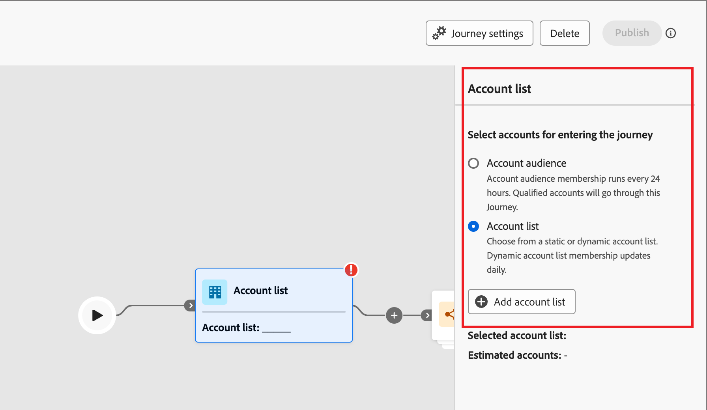
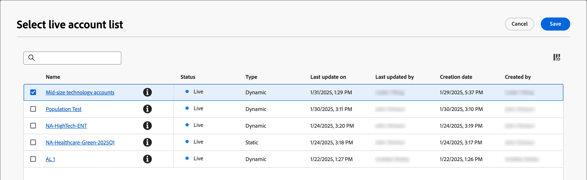
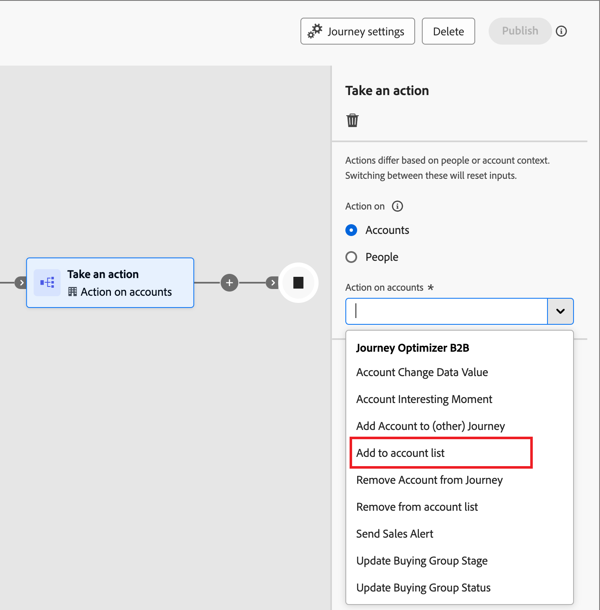
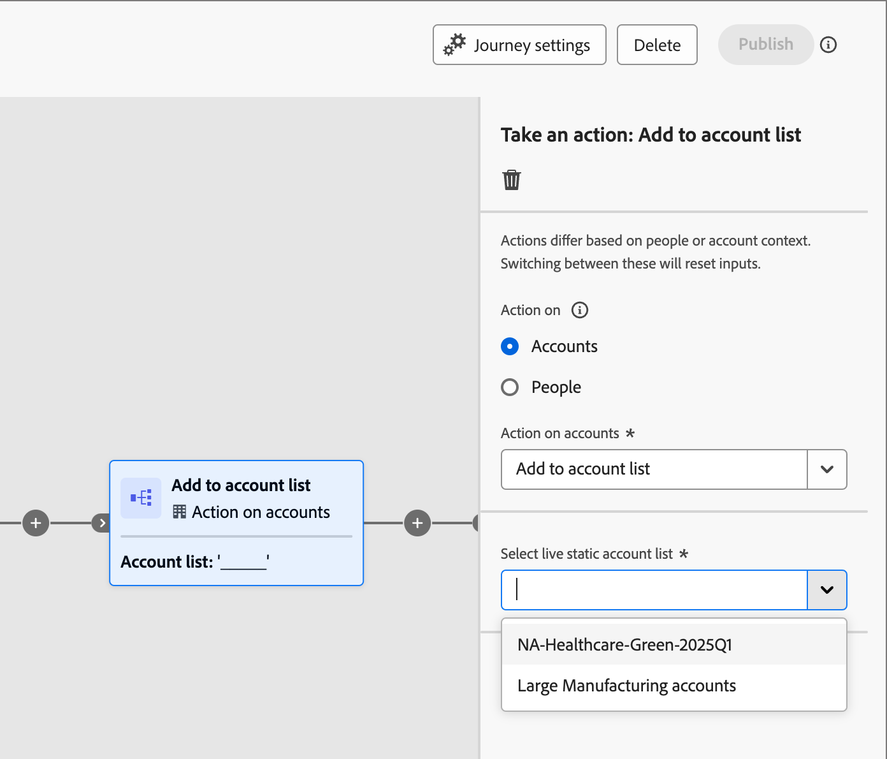
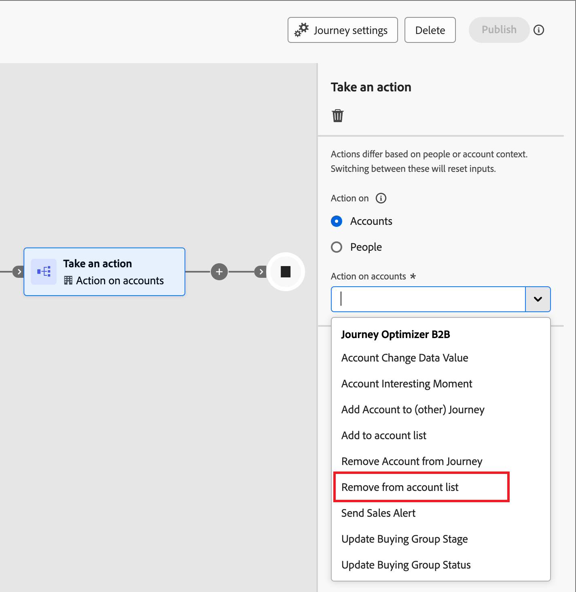
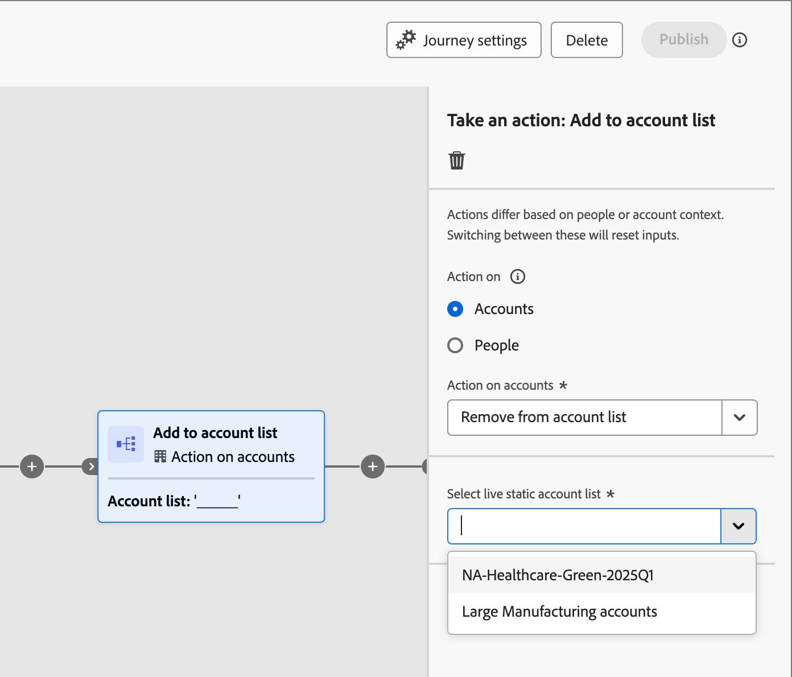

# Verwenden von Kontolisten in Journey

Es gibt mehrere Möglichkeiten, Live (veröffentlichte)-Account-Listen in die Account-Journey zu integrieren.

## Konto-Zielgruppenknoten

Alle Account-Journey beginnen mit einem [_Account-Zielgruppe_-Knoten](../journeys/account-audience-nodes.md). Wenn Sie diesen Knoten so einstellen, dass er eine Kontenliste verwendet, durchlaufen die Mitgliederkonten die Journey, sobald sie live (veröffentlicht) geschaltet wird.

1. Wählen Sie die Option **[!UICONTROL Kontoliste]** für den _Kontozielgruppe_ Startknoten aus.

   {width="500"}

1. Klicken Sie **[!UICONTROL Kontoliste hinzufügen]**.

1. Aktivieren Sie das Kontrollkästchen für die Kontoliste und klicken Sie auf **[!UICONTROL Speichern]**.

   {width="600" zoomable="yes"}

## Aktionsknoten ausführen - Zum Konto hinzufügen

**_Nur statische Kontolisten_**

Fügen Sie innerhalb einer Konto-Journey Konten mithilfe eines [einer Aktion _-_ zu einer statischen Kontoliste ](../journeys/action-nodes.md).

Sie haben beispielsweise einen Journey-Pfad, über den Sie eine E-Mail senden, und einige Konten führen als Antwort verschiedene Aktionen aus. Sie betrachten diese Aktivität als Qualifizierungspunkt auf der Journey. Mit der Qualifizierung können Sie sie zu einer Kontenliste hinzufügen, die als Zielgruppe für eine andere Journey mit einem anderen Fluss für qualifizierte Konten verwendet wird.

>[!NOTE]
>
>Wenn sich zum Zeitpunkt der Ausführung des Knotens bereits ein Konto in der Liste befindet, wird die Aktion ignoriert.

1. Wählen Sie die Option _[!UICONTROL Aktion auf]_ **[!UICONTROL Konten]** aus.

1. Wählen Sie _[!UICONTROL Aktion für Konten]_ die Option **[!UICONTROL Zur Kontoliste hinzufügen]** aus.

   {width="500"}

1. Wählen **[!UICONTROL unter „Live-]**-Kontoliste auswählen“ die Kontoliste aus, der Sie Konten hinzufügen möchten.

   {width="500"}

## Aktionsknoten ausführen - Aus Konto entfernen

**_Nur statische Kontolisten_**

Entfernen Sie auf einer Konto-Journey Konten mithilfe des Knotens [Aktion ausführen _aus_ statischen ](../journeys/action-nodes.md).

Sie haben beispielsweise einen Journey-Pfad, über den Sie eine E-Mail senden, und einige Konten führen als Antwort verschiedene Aktionen aus. Sie betrachten diese Aktivität als Qualifizierungspunkt auf der Journey. Mit dieser Qualifizierung möchten Sie sie aus einer Kontoliste entfernen. Diese Liste wird als Audience für eine andere Journey verwendet, die zusätzliche E-Mails sendet, damit Sie Ihre Qualifizierungskommunikationen nicht duplizieren.

>[!NOTE]
>
>Wenn sich ein Konto nicht in der Liste befindet, aus der es entfernt werden soll, wird die Aktion ignoriert.

1. Wählen Sie die Option _[!UICONTROL Aktion auf]_ **[!UICONTROL Konten]** aus.

1. Wählen Sie _[!UICONTROL Aktion für Konten]_ die Option **[!UICONTROL Aus Kontoliste entfernen]** aus.

   {width="500"}

1. Wählen **[!UICONTROL unter „Live-]**-Kontoliste auswählen“ die Kontoliste aus, aus der Sie Konten entfernen möchten.

   {width="500"}
