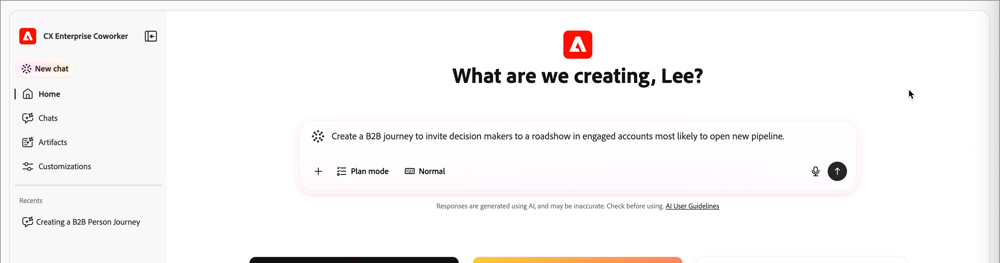

# Journey-Kenntnisse für B2B

Verwenden Sie [!DNL Adobe CX Enterprise Coworker] Chat, um in [!DNL Adobe Journey Optimizer B2B Edition] Journey zu finden, zu erstellen und zu konfigurieren. Erstellen Sie validierte Entwürfe aus einer Zusammenfassung, ändern Sie gespeicherte Entwurfsdiagramme und Wiedereinstiegseinstellungen und konfigurieren Sie nicht konfigurierte Knoten. Journey-Änderungen gelten für gespeicherte Entwürfe, nicht für aktive Journey.

Die Kennungen für Kenntnisse und die unterstützten Aktionen zu Lookup, Erstellung und Regeln finden Sie in der [Referenz zu Journey-Kenntnissen für Kollegen](./coworker-overview.md#skills). Dieser Artikel enthält eine kurze Anleitung zur Vorbereitung und Beispiele für die Journey-Beobachtbarkeit:

* [Anleitung zur Erstellung von Journey](#journey-creation-skills): Bereiten Sie eine Zusammenfassung vor und überprüfen Sie einen Entwurf, bevor Sie ihn erstellen.
* [Anleitung zur Journey-Beobachtung](#journey-observability-skills): Stellen Sie Fragen darüber, wie Konten und Personen durch aktive Journey navigieren.

Anweisungen zum Öffnen der App und zum Starten von Konversationen finden Sie im [Handbuch zur -Benutzeroberfläche](https://experienceleague.adobe.com/de/docs/coworker/content/chat/ui-guide){target="_blank"}.

## Journey-Erstellungsfähigkeiten {#journey-creation-skills}

Die Fähigkeit zur Journey-Erstellung wandelt eine Zusammenfassung in ein validiertes Konto- oder Personen-Journey-Diagramm um. Die benannte Zielgruppe wird in ihre [!DNL Adobe Experience Platform] Zielgruppen-ID aufgelöst und das Diagramm wird in der Vorschau angezeigt, bevor ein Entwurf erstellt wird.

Sie müssen die Vorschau explizit genehmigen, bevor [!DNL Coworker] den Entwurf erstellt. Die Fähigkeit zum Erstellen erkennt keine Zielgruppen, konfiguriert keine Knotenregeln, erstellt keine Nachrichtenkopien, veröffentlicht keine Journey oder löscht sie.

### Einen Überblick vorbereiten {#basic-usage}

Beschreiben Sie die gewünschte Journey in natürlicher Sprache. Fügen Sie die folgenden Details hinzu:

* Journey-Typ: Konto oder Person.
* Vorhandene Zielgruppe: Der Name oder die ID der zu verwendenden Zielgruppe.
* Journey-Fluss: Die Aktionen, Wartezeiten und Verzweigungen, die einbezogen werden sollen.
* Einstellungen für den erneuten Eintritt: Gibt an, ob und wann Konten oder Personen erneut eingegeben werden können.

Binden Sie relevante Details aus Ihrer Kampagnenbeschreibung ein, damit [!DNL Coworker] das Ziel interpretieren können. Verfeinern Sie die Anfrage, wenn die Vorschau nicht Ihrem beabsichtigten Fluss entspricht.

{width="800" zoomable="yes"}

### Entwurf überprüfen und erstellen {#end-to-end-b2b-journey-creation}

Überprüfen Sie den Journey-Typ, die aufgelöste Zielgruppe, die Knoten und Pfade in der validierten Vorschau. Die Erstellung nur genehmigen, wenn das Diagramm Ihrem Auftrag entspricht.

Nach der Genehmigung erstellt [!DNL Coworker] den Entwurf und gibt dessen Link zurück. Verwenden Sie eine Folgeanfrage, um die nicht konfigurierten Knoten mithilfe der Regelqualifikation zu konfigurieren. Fügen Sie eine Nachrichtenkopie in die Anwendung ein und schließen Sie dann die Schritte zur Überprüfung und Veröffentlichung von [Journey ab](../journeys/create-publish-journey.md).

Ein vollständiges Beispiel finden Sie unter [Erstellen einer Konto-Journey](./coworker-overview.md#build-account-journey).

### Mehrstufige Journey

Beschreiben Sie für eine Journey mit mehreren Phasen die Aktionen, Wartezeiten und Verzweigungen jeder Phase in der Zusammenfassung. Unterscheiden Sie die Diagrammstruktur von den Regeln und Nachrichtenkopien, die Sie nach der Entwurfserstellung konfigurieren.

Um einen gespeicherten Entwurf zu überarbeiten, fordern Sie das Diagramm an oder nehmen Sie über die Erstellungsfertigkeit Änderungen erneut vor. Verwenden Sie die Qualifikationsregeln für Aufspaltungsbedingungen, Aktionen, Ereignisse und die dynamische Audience-Liste auf nicht konfigurierten Knoten.

## Journey Observability Skills {#journey-observability-skills}

Mit den Journey-Beobachtungsfähigkeiten können Sie Fragen zur natürlichen Sprache stellen, wie Konten und Personen sich durch Ihre B2B-Journey bewegen - ohne sich durch Journey-Karten, Protokolle oder Dashboards zu wühlen. Sie decken zwei Hauptbereiche ab: die Journey-Progression und die Datensynchronisierungsbeobachtbarkeit.

![Eingabeaufforderung zur Beobachtung von Journey und Antwort in [!DNL CX Coworker]](./assets/journey-observability-prompt-response.png){width="800" zoomable="yes"}

### Journey insight auf Kontoebene

Verfolgen Sie, wie ein bestimmter Account durch eine Journey floss, indem Sie Fragen stellen wie:

* „Geben Sie mir grundlegende Informationen zu Bodea Cloud-Konten.“
* „Erzählen Sie mir, wie der Account Northstar Services die Journey-ABM-Nurture-Strategie durchlief.“
* „Wann hat Account Contoso LLC diese Journey gestartet?“

### Argumentation und Zählungen bei Aufspaltungen

Verstehen, warum eine Verzweigung erstellt wurde und wie viele Personen oder Konten jedem Pfad gefolgt sind:

* „Warum ist das Konto QiDemoAccount24 auf den kleinen US-amerikanischen Technologiepfad bei Split Node c764a9 gegangen?“
* „Geben Sie mir die Anzahl der Personen für jeden Pfad im geteilten Knoten-459c7c.“
* „Personen auf dem San Jose-Pfad für Account8 zeigen.“

Journey Observability Skills analysieren Aufspaltungslogik, Account-Attribute und Aktivitäten, um Routing-Entscheidungen zu erklären und Zählungen pro Pfad oder Personenlisten zurückzugeben.

### Journey-Ergebnisse auf Benutzerebene

Analysieren Sie einzelne Ergebnisse innerhalb eines Accounts oder auf einer ganzen Journey. Dies ist besonders nützlich für die Kaufgruppenanalyse und das Tracking von Entscheidungsträgern vs. Influencer-Verhalten:

* „Geben Sie mir die Anzahl der Personen in jedem Aufspaltungspfad für die Bodea Next Web Engagement Journey.“
* „Listen Sie Personen im ausgeblendeten Überspringpfad auf.“
* „Personen für dieses Konto im Standortpfad von San Diego anzeigen.“

### Journey-Lebenszyklus und -Timing

Abrufen wichtiger Zeitstempel für eine Journey oder bestimmte Konten:

* „Wann ist diese Journey live gegangen?“
* „Wann ist das erste Konto auf diese Journey gelangt?“
* „Wann hat Account QiDemoAccount50 diese Journey gestartet?“

### Sichtbarkeit von externer Zielgruppe und Aktivierung

Bei Journey, die auf externe Kanäle wie LinkedIn pushen, können Sie den Aktivierungsstatus überprüfen:

* „Ist bsmith@acme.com in der externen Zielgruppe?“
* „Listen Sie alle Personen auf, die über ObservabilityExtAudience01 für LinkedIn aktiviert wurden.“

### Datensynchronisierung und Pipeline-Beobachtbarkeit

Die Journey-Beobachtungsfähigkeiten können auch Informationen zum Zustand der Datensynchronisation enthalten, um die Fehlerbehebung zu unterstützen, warum ein Konto oder Lead nicht in einer Journey enthalten war:

* Auftragsmetriken und Status für externen Zielgruppenexport
* Batch-Segmentierungspläne und Abschlusszeiten
* Wartungsplanung für Einkaufsgruppen
* Job Manager-Status (abgeschlossen/fehlgeschlagen)