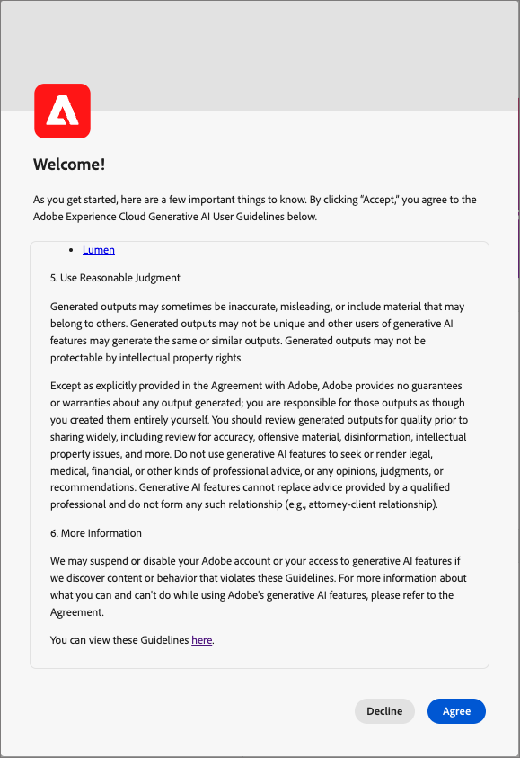

# KI-Funktionen in Journey Optimizer B2B Edition

Nutzen Sie KI-Funktionen in [!DNL Adobe Journey Optimizer B2B Edition], um Inhalte zu generieren, Produktkenntnisse zu erkunden und operative Erkenntnisse zu gewinnen.

>[!IMPORTANT]
>
>Bevor Sie KI-Funktionen in [!DNL Journey Optimizer B2B Edition] verwenden können[&#x200B; ist eine Vereinbarung mit den &#x200B;](https://www.adobe.com/de/legal/licenses-terms/adobe-gen-ai-user-guidelines.html){target="_blank"}Benutzerrichtlinien“ erforderlich. Diese Vereinbarung enthält auch die öffentliche Beta-Vereinbarung, sodass Sie beim Rollout zusätzliche KI-aktivierte Funktionen verwenden können.

+++Benutzeroberfläche der Benutzervereinbarung anzeigen

+++

## Verwenden der [!DNL Coworker] App {#coworker-app}

Verwenden Sie die Benutzeroberfläche der [!DNL CX Enterprise Coworker]-App für alle Chat-Workflows außer der Inhaltserstellung. Stellen Sie Produktfragen, erkunden Sie operative Einblicke und verwenden Sie [Journey-](../agents/journey-agent.md) und [Zielgruppen-Kenntnisse für B2B-Accounts und Personen](../agents/audience-agent-b2b.md). Die Inhaltserstellung bleibt in [!DNL Journey Optimizer B2B Edition] verfügbar.

Anweisungen zum Öffnen der App, Starten von Konversationen und Verwenden von Chat-Funktionen finden Sie im Handbuch zur [CX Coworker-Benutzeroberfläche](https://experienceleague.adobe.com/en/docs/coworker/content/chat/ui-guide){target="_blank"}.

Überlegen Sie, welche Art von Anfrage Sie benötigen, bevor Sie eine [!DNL Coworker] Chat-Abfrage senden.

### Produktkenntnisse

Produktkenntnisse beziehen sich auf Konzepte und Themen, die auf der [!DNL Journey Optimizer B2B Edition] Dokumentation zu [!DNL Adobe Experience League] basieren. Fragen zum Produktwissen können in den folgenden Untergruppen genauer spezifiziert werden:

| Produktkenntnisse | Beispiele |
| --- | --- |
| Punktuelles Lernen | <li>Was ist eine Einkaufsgruppe? <li> Beispiel für eine Vorlage für Einkaufsgruppen-Rollen anzeigen? |
| Offene Erkennung | <li>Was sind die Schritte zum Erstellen von Einkaufsgruppen? <li>Wie verwende ich benutzerdefinierte Felder in einer Vorlage für Einkaufsgruppen-Rollen? |
| Fehlerbehebung | <li>Warum wurden keine Gruppen für meinen Journey erstellt? <li>Warum kann ich in der Journey keine Erlebnisereignisse finden, die angehört werden sollen? |

### Betriebliche Erkenntnisse

_Operative Einblicke_ beziehen sich auf Antworten, die [!DNL Coworker] über Ihre Metadatenobjekte generiert (Attribute, Kontozielgruppen, Datenflüsse, Datensätze, Ziele, Account-Journey, Schemata, Quellen, Einkaufsgruppenvorlagen und Lösungsinteressen). Zu diesen Einblicken gehören Zählungen, Suchen und Auswirkungen auf die Herkunft. Sie sehen sich keine Daten innerhalb der Sandbox an.

* Welche Konto-Zielgruppe hat die größte Zielgruppengröße und wie groß ist diese?
* Wie viele Konto-Zielgruppen wurden noch nie in einer Journey verwendet?
* Welche aktiven Journey verwenden Lösungsinteresse _x_?

Sie können [!DNL Coworker] Fragen zu Ihren betrieblichen Erkenntnissen in den folgenden Bereichen stellen:

| Domain | Unterstützte Metadaten | Nicht unterstützte Metadaten |
| --- | --- | --- |
| Attribute/Felder | <li>Suche nach Attributnamen <li>Attribut - Schemabeziehung <li>Attribut - Datensatzbeziehung <li>Attribut - Zielgruppenbeziehung <li>Attribut - Zielbeziehung | <li>Attributklasse <li>Verfolgung <li>Veraltungsstatus <li>Labels <li>In Attributen gespeicherter Wert |
| Account Audiences   **_Hinweis:_** Im [!DNL Journey Optimizer B2B Edition] Kontext kann [!DNL Coworker] Chat nur Audience-Fragen für Account Audiences beantworten. Im [!DNL Adobe Experience Platform] Kontext kann [!DNL Coworker] Chat Fragen nur für Personen-Zielgruppen beantworten. | <li>Zielgruppengröße <li>Zielgruppentyp (Streaming oder Batch) <li>Erstellungs-/Änderungsdatum <li>Aktivierungsstatus <li>Anzahl der Mitglieder <li>Duplizieren von Zielgruppen <li>Name- und ID-Suche | <li>Zielgruppenüberschneidungen <li>Zielgruppenaktivierung <li>Verfolgung <li>Erstellen/Ändern <li>Labels <li>Trends bei der Mitgliederqualifizierung |
| Datenflüsse | <li>Anzahl der Datenflüsse <li>Datenflussstatus <li>Datenfluss - Datensatzbeziehung <li>Datenfluss-Quelle-Beziehung | <li>Erstellung/Änderung <li>Datenfluss-Batch-Beziehungen <li>Anzahl der aufgenommenen Profile |
| Datensätze | <li>Anzahl der Datensätze <li>Profilaktivierungsstatus <li>Erstellungs-/Änderungsdatum <li>Datensatz - Schemabeziehung <li>Datensatz-Zielgruppen-Beziehung <li>Datensatz - Attributbeziehung <li>Datensatz - Datenflussbeziehung <li>Namenssuche <li>Name- und ID-Suche | <li>Verfolgung <li>Erstellt von <li>Datensatz - Batch-Beziehung <li>Erstellen/Ändern von Datensätzen <li>Datensatzgröße <li>Anzahl der Profile <li>Anzahl Zeilen <li>Wertesuche |
| Ziele | <li>Konfigurierte Zielzählungen <li>Ziel - Zielgruppenbeziehung <li>Zielattributbeziehung | <li>Konto-Setup <li>Informationen zu Kontoanmeldeinformationen <li>Eindeutige Profile aktiviert |
| Journey (Account Journey) | <li>Count <li>Name- und ID-Suche <li>Journey-Status <li>Erstellungs-/Änderungsdatum | <li>Attribute - Journey-Beziehungen <li>Verfolgung <li>Erstellung/Änderung <li>Erstellt von |
| Schemata | <li>Anzahl der Schemata <li>Erstellungs-/Änderungsdatum <li>Schema - Attributbeziehung <li>Schema - Datensatzbeziehung <li>Schema - Zielgruppenbeziehung <li>Profilaktivierungsstatus <li>Namenssuche <li>Name- und ID-Suche | <li>Verfolgung <li>Erstellung/Änderung <li>Erstellt von <li>Feldergruppen <li>Identitäten <li>Identity-Namespaces <li>Labels <li>Anzahl der Profile |
| Quellen | <li>Anzahl der Konten <li>Kontostatus <li>Aktive/inaktive Datenflüsse für jedes Konto <li>Source-Connector - Datenflussbeziehung <li>Source-Konto - Datenflussbeziehung | <li>Informationen zu Kontoanmeldeinformationen <li>Konto-SetupDatenaufnahme -Metriken <li>Anzahl der ProfileQuelle - Batch-Beziehungen |
| Einkaufsgruppenvorlage | <li>Zählungen <li>Status <li>Rollen <li>Name- und ID-Suche | <li>Rollenregeln |
| Interesse an der Lösung | <li>Zählungen <li>Status <li>Interesse an der Lösung - Beziehung der Einkaufsgruppenvorlage <li>Name- und ID-Suche | <li>Lösungsinteresse - Kauf-Gruppenbeziehung |

{style="table-layout:fixed"}

Bei Fragen zu operativen Einblicken spiegeln die Antworten möglicherweise nicht den aktuellen Status der Benutzeroberfläche wider. Die Daten, die diese Fragen stützen, werden alle 24 Stunden einmal aktualisiert. Änderungen, die Benutzer tagsüber in [!DNL Adobe Real-Time Customer Data Platform] vornehmen, werden beispielsweise nachts mit den Datenspeichern synchronisiert und stehen dann morgens für Benutzerfragen zur Verfügung. Um bestimmte Daten im Zusammenhang mit Objekten abzufragen, melden Sie sich bei einer Sandbox an.

### Datenschutz, Sicherheit und Governance

[!DNL Coworker] Chat in [!DNL Journey Optimizer B2B Edition] priorisiert Datenschutz, Sicherheit und Governance. Lesen Sie die folgenden Informationen, um mehr über die auf das Kundenvertrauen fokussierten Funktionen zu erfahren, die Sie von [!DNL Coworker] Chat erwarten können:

* [!DNL Coworker] verwendet personenbezogene Daten heutzutage nicht mehr, auch nicht zu Schulungszwecken.

* Sie können ein 30-tägiges Protokoll Ihrer vorherigen Interaktionen mit [!DNL Coworker] Chat anzeigen.

* [!DNL Coworker] basiert auf Sandbox-spezifischen Daten und der öffentlichen Adobe-Dokumentation, wenn auf Eingabeaufforderungen reagiert wird. Daten werden nicht über Sandboxes hinweg freigegeben.

* Eingabeaufforderungen, die Sie für [!DNL Coworker] Chat bereitstellen, werden nicht an andere Kunden weitergegeben.

## Nächste Schritte

Fahren Sie mit allgemeinen Kenntnissen über [!DNL Coworker] Chat fort, um ihn während Ihrer Workflows zu aktivieren und zu verwenden. Weiterführende Informationen finden Sie in der folgenden Dokumentation:

* [Aktivieren des Zugriffs auf KI-Funktionen](./enable-ai-access.md)
* [Anleitung zu Fragen](./question-guidance.md)
* [Handbuch zur CX Coworker-Benutzeroberfläche](https://experienceleague.adobe.com/en/docs/coworker/content/chat/ui-guide){target="_blank"}
