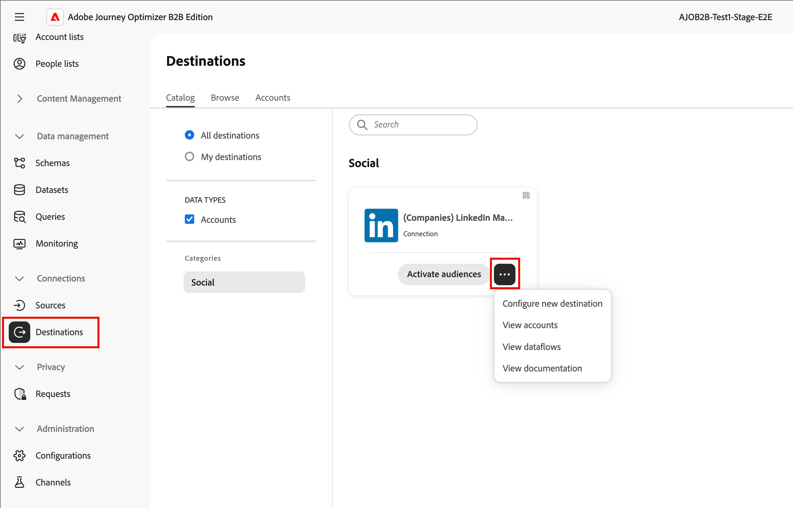

# Ziele

Ziele sind vorgefertigte Integrationen, mit denen Sie [statische Personenlisten)-Mitglieder ](./people-lists-static.md) Konto-Journey-Zielgruppen an soziale Plattformen senden können. Durch das Aktivieren einer statischen Liste für ein Ziel wird die Mitgliedschaft synchron gehalten. Wenn Personen der Liste hinzugefügt oder daraus entfernt werden, werden sie entsprechend der Zielgruppe und entsprechend jeder Kampagne, die von der Zielgruppe bedient wird, hinzugefügt oder daraus entfernt.

Es gibt drei Möglichkeiten, Personen für ein verbundenes Ziel zu aktivieren:

* **Aus einer statischen Liste** - Aktivieren Sie eine vorhandene statische Liste direkt auf der Registerkarte **_[!UICONTROL Personenlisten]_**. Siehe [_Für ein Ziel aktivieren_](./people-lists-static.md#static-list-activate).
* **Von einem Konto-Journey** - Fügen Sie einen Aktionsknoten **_[!UICONTROL Für Ziel aktivieren]_** zu einem Journey-Pfad hinzu, damit qualifizierte Konten für das Ziel aktiviert werden, wenn sie diesen Knoten erreichen. Siehe [_Aktivieren für oder Deaktivieren für ein Ziel_](../journeys/action-nodes.md#activate-deactivate-destination).
* **Von einer Einkaufsgruppe** - Um leere Rollen in Ihren Einkaufsgruppen auszufüllen, können Sie eine LinkedIn Matched Audience aktivieren, um Interessenten anzusprechen, die Ihren Einkaufsgruppenparametern entsprechen. Siehe [_LinkedIn-Konto mit übereinstimmenden Zielgruppen](../data/linkedin-account-matched-audiences.md#activate-buying-group).

>[!BEGINSHADEBOX]

## Erforderliche Berechtigungen {#required-permissions}

Für die Funktion „Vollständiges Ziel“ sind die folgenden [!DNL Adobe Experience Platform] erforderlich.

| Kategorie | Berechtigung |
|--- |--- |--- |
| Sandboxes | Sandbox-Zugriff |
| Dashboards | Standard-Dashboards anzeigen |
| Dashboards | Standard-Dashboards verwalten |
| Ziele | Anzeigen von Zielen |
| Ziele | Verwalten von Zielen |
| Ziele | Aktivieren von Zielen |
| Ziele | Segment ohne Zuordnung aktivieren |
| Ziele | Verwalten und Aktivieren des Datensatzziels |
| Ziele | Ziel-Authoring |
| Data Governance | Anzeigen von Datennutzungsrichtlinien |
| Data Governance | Verwalten von Datennutzungsrichtlinien |
| Datenaufnahme | Anzeigen von Quellen |
| Datenaufnahme | Verwalten von Quellen |
| Profilverwaltung | Profileinstellungen anzeigen |
| Profilverwaltung | Profileinstellungen verwalten |

>[!ENDSHADEBOX]

## Unterstützte Ziele {#supported-destinations}

Bevor Sie eine statische Liste aktivieren können, muss im Zielkatalog ein Ziel vorhanden sein. Erweitern Sie in der linken Navigation **[!UICONTROL Verbindungen]** und wählen Sie **[!UICONTROL Ziele]** aus. [!DNL Journey Optimizer B2B Edition] unterstützt derzeit das Ziel **[!UICONTROL LinkedIn Matched Audience]** (Social) . Siehe [_LinkedIn-Konto - Zugeordnete Zielgruppen_](../data/linkedin-account-matched-audiences.md) bis

<!-- 
the following destinations:

* **[!UICONTROL Google Customer Match]** (Advertising)
* **[!UICONTROL Facebook Custom Audience]** (Social)
* **[!UICONTROL LinkedIn Matched Audience]** (Social)

{width="800" zoomable="yes"}

-->

>[!NOTE]
>
>Der angezeigte Katalog ist nicht der vollständige [!DNL Adobe Experience Platform]. Wenn Sie direkt über [!DNL Experience Platform] auf Ziele zugreifen, sehen Sie einen größeren Katalog, aber nur diese Ziele sind derzeit für die Aktivierung in [!DNL Journey Optimizer B2B Edition] verfügbar. Weitere Ziele sind für zukünftige Versionen geplant.

## Ziel einrichten {#set-up-destination}

Jede unterstützte Zielkarte zeigt **[!UICONTROL Neues Ziel konfigurieren]**. Die Konfiguration eines Ziels ist eine Voraussetzung für die Aktivierung.

1. Klicken Sie auf der Connector-Karte auf **[!UICONTROL Neues Ziel konfigurieren]**.

   {width="500"}

1. Wählen Sie **[!UICONTROL Vorhandenes Konto]** oder **[!UICONTROL Neues]** aus und geben Sie die Kontodetails ein, z. B. den Kontonamen und die Beschreibung.

1. Klicken Sie **[!UICONTROL Mit Ziel verbinden]**.

   Mit einem OAuth-Fluss können Sie sich beim entsprechenden Konto anmelden: LinkedIn, Google oder Facebook.

   >[!IMPORTANT]
   >
   >Geben Sie an dieser Stelle nicht die _[!UICONTROL Zieldetails]_ ein. Es wird nur die Verbindung benötigt.

1. Schließen Sie die erforderliche Feldzuordnung zwischen Personenattributen und den für das Ziel erforderlichen Feldern ab.

1. Überprüfen Sie die Einstellungen für Data Governance und Marketing-Aktionen und klicken Sie dann auf **[!UICONTROL Speichern]**.

Die vollständigen Einrichtungsschritte finden Sie unter [Erstellen einer neuen Zielverbindung](https://experienceleague.adobe.com/en/docs/experience-platform/destinations/ui/connect-destination){target="_blank"} in der [!DNL Experience Platform].

Nach der Konfiguration kann das Ziel überall dort aktiviert werden, wo Sie ein Ziel in [!DNL Journey Optimizer B2B Edition] auswählen können.

## Aktivierung und Synchronisierung {#activation-sync}

Die Aktivierung wird durch die Zugehörigkeit zu einer statischen Liste gesteuert, wobei eine bidirektionale Synchronisierung zwischen der Liste und der Zielgruppe erfolgt:

* Wenn Sie eine Person zur statischen Liste hinzufügen, wird sie innerhalb von 24 Stunden zum Ziel aktiviert, indem Sie sie zur Ziel-Audience und anschließend zu jeder Kampagne hinzufügen, die von der Audience gefüttert wird.
* Wenn Sie eine Person aus der statischen Liste entfernen, wird sie im Ziel deaktiviert. Sie werden aus der Zielgruppe und aus jeder verbundenen Kampagne entfernt.
* Dieselbe Liste kann für mehrere Ziele gleichzeitig aktiviert werden. Die Mitgliedschaft synchronisiert alle mit ihnen.

>[!TIP]
>
>Um eine LinkedIn-Kampagne für ein Segment auszuführen, aktivieren Sie die statische Liste dieser Personen für Ihr Ziel „LinkedIn Matched Audience“. Alle Personen in der Liste werden der entsprechenden Zielgruppe in LinkedIn hinzugefügt, wo eine Kampagne sie ansprechen kann. Die Zielgruppe bleibt bei Änderungen der Liste automatisch auf dem neuesten Stand.
