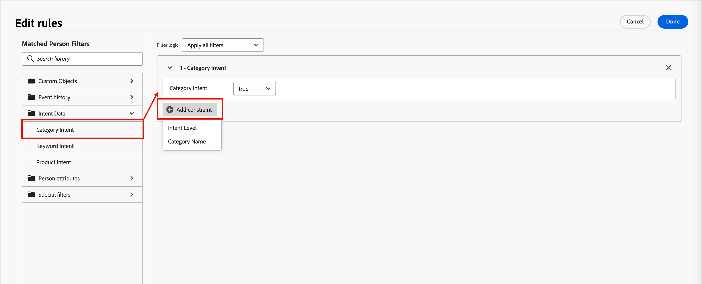

# Dynamische Personenlisten

Eine dynamische [Personenliste](./people-lists.md) ist eine Sammlung von Personenprofilen, die durch Regeln (Filter) definiert wird. Die Zugehörigkeit zu einer dynamischen Liste wird mithilfe einfacher Filter definiert, die auf Personenattribute und -aktivitäten verweisen. Die Mitgliedschaft wird automatisch beibehalten, da Profile gemäß der Filterlogik qualifiziert und disqualifiziert werden.

Sie können keine einzelnen Personen zu einer dynamischen Liste hinzufügen oder daraus entfernen. Um die Mitgliedschaft in der Liste zu ändern, aktualisieren Sie die Regeln. Wenn Sie die Mitgliedschaft manuell oder über eine Journey verwalten müssen, verwenden Sie stattdessen eine [statische Liste](./people-lists-static.md).

## Festlegen von Mitgliedschaftsregeln {#set-membership-rules}

>[!NOTE]
>
>Eine dynamische Liste ohne Regeln hat keine Mitglieder. Fügen Sie mindestens einen Filter hinzu, um die Liste zu füllen.

1. Öffnen Sie die dynamische Liste und wählen Sie die Registerkarte **[!UICONTROL Regeln]** aus.

1. Klicken Sie **[!UICONTROL Regeln bearbeiten]**.

   {width="700" zoomable="yes"}

1. Definieren _[!UICONTROL im Dialogfeld „Regeln]_&quot; die Regeln für das Qualifizieren von Profilen, indem Sie Filter aus dem linken Bereich ziehen.

   Profile für die Liste qualifizieren, indem eine beliebige Kombination aus Folgendem verwendet wird:

   * Aktivitätsverlauf
   * [!DNL Experience Platform] Personenfelder
   * Benutzerdefinierte Felder
   * Absichtsdaten
   * Personenattribute
   * Spezielle Filter, z. B. Journey-Mitgliedschaft

   Klicken Sie für jeden hinzugefügten Filter auf **[!UICONTROL Beschränkungen hinzufügen]**, um die entsprechenden Kriterien zu verfeinern. Passen Sie Ihre Bedingungen durch Anwendung der **[!UICONTROL Filterlogik]** oben an. Sie können festlegen, dass alle Bedingungen, alle Bedingungen erfüllt werden, oder eine erweiterte Logik definieren.

   {width="700" zoomable="yes"}

1. Klicken Sie **[!UICONTROL Fertig]**, um Ihre Änderungen zu speichern.

   Auf der Registerkarte **[!UICONTROL Regeln]** werden die Filter und die Filterlogik für die Liste angezeigt, und auf der Registerkarte **[!UICONTROL Mitglieder]** wird die aktualisierte Mitgliedschaft aktualisiert. Um die aktuellsten Zielgruppenqualifikationen zu finden, verwenden Sie **[!UICONTROL Mitglieder aktualisieren]** im Menü **[!UICONTROL Mehr]**.

1. Wählen Sie die **[!UICONTROL Mitglieder]** aus.

   Qualifizierende Mitglieder werden nach kurzer Verzögerung in der Liste angezeigt.

   {width="700" zoomable="yes"}

>[!NOTE]
>
>Um die Listenregeln jederzeit zu ändern, können Sie diese Schritte wiederholen. Die Mitgliedschaftsliste wird basierend auf den gespeicherten Filtern aktualisiert.

<!--

## Duplicate a dynamic list {#duplicate-dynamic-list}

Duplicating a dynamic list replicates its membership filtering so that you can reuse it in a different context.

1. In the _[!UICONTROL Dynamic lists]_ tab, click the _More menu_ ( **...** ) icon next to the list and choose **[!UICONTROL Duplicate]**.

1. Enter a unique **[!UICONTROL Name]** (required) and a **[!UICONTROL Description]** (optional).

   By default, the dialog appends `_copy` to the name of the originating list. Enter a different unique name as needed.

   {width="375"}

1. Click **[!UICONTROL Duplicate]**.
-->
