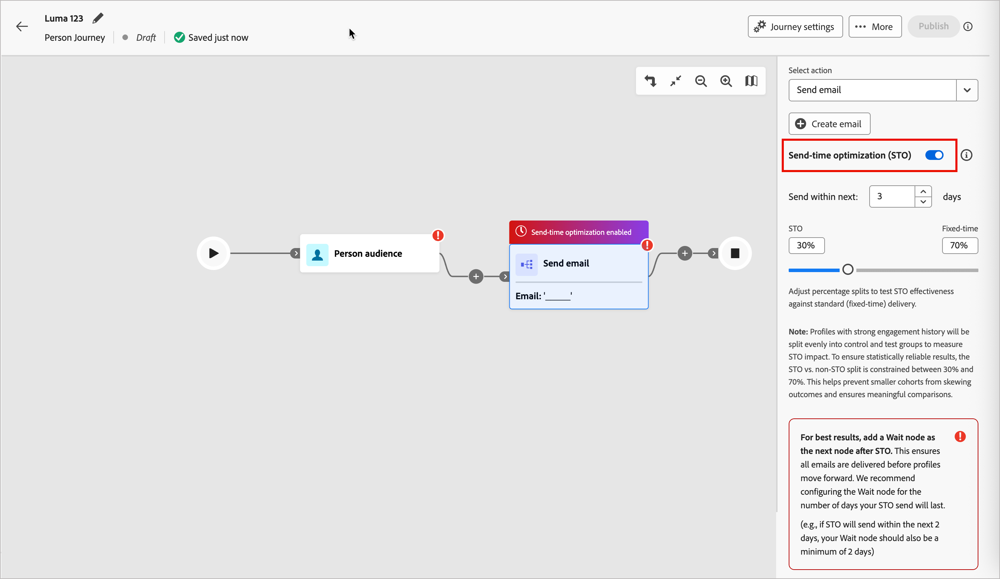

# Optimierung des E-Mail-Versandzeitpunkts

Verwenden Sie die Funktion „Optimierung des Versandzeitpunkts (STO)“, um den Versandzeitpunkt von E-Mails für [Personen-Journey](../journeys/journeys-overview.md) zu personalisieren, indem Sie vorhersagen, wann jedes Profil am ehesten interagieren wird. Anstelle einer festen Versandzeit verwendet STO historische E-Mail-Interaktionssignale, um den Versand für jeden Empfänger zum optimalen Zeitpunkt zu planen und so die Interaktion insgesamt zu verbessern.

STO analysiert die historischen Interaktionen jedes Profils mithilfe eines großen Sprachmodells. Er sagt potenzielle Versandzeitpunkte voraus und stuft sie ein, und plant dann den Versand zum Zeitpunkt, der im Optimierungsfenster am höchsten rangiert.

## Aktuelle Verfügbarkeit und aktueller Umfang

Die Sendezeitoptimierung wird derzeit unterstützt für:

* **Journey-Typ**: Personen-Journey
* **channel**: email
* **Konfiguration**: _E-Mail senden_ Aktionsknoten
* **Reporting**: [!DNL Coworker] Chat durch die Journey-Beobachtungsfähigkeiten

  Leistungseinblicke wie Verwendung, Interaktionssteigerung und STO-Vergleiche mit Nicht-STO-Vergleichen sind über Abfragen in natürlicher Sprache in [!DNL Coworker] Chat verfügbar.

>[!BEGINSHADEBOX]

Es sind viele **_zukünftige Verbesserungen_** für STO geplant:

* Unterstützung für _Account-Journey_
* Globale STO-Konfiguration im Bereich _[!UICONTROL Administration]_
* STO-Aktivierung auf Journey-Ebene
* Konfigurierbare Test-/Kontrollaufteilungen
* Ein dediziertes STO-Reporting-Dashboard

>[!ENDSHADEBOX]

## Konfiguration

Sie können die Sendezeitoptimierung konfigurieren, wenn Sie [&#x200B; Personen-Journey einen _[!UICONTROL Aktion ausführen]_-](../journeys/action-nodes.md) hinzufügen.

1. Wählen Sie für _[!UICONTROL Aktion auswählen]_ die Option **[!UICONTROL E-Mail senden]**.

1. Verwenden Sie den Umschalter **[!UICONTROL Sendezeitoptimierung]**, um die Funktion zu aktivieren.

1. Um das Fenster und die Testverteilung festzulegen, legen Sie die STO-Optionen fest:

   * **[!UICONTROL Senden innerhalb der nächsten]** - Dieser Wert bestimmt das Optimierungsfenster (in Tagen), das den Zeitraum angibt, in dem E-Mails zugestellt werden können. Ein Webinar, das beispielsweise in fünf Tagen stattfindet, kann vier oder fünf Tage dauern. STO wählt für jedes Profil in diesem Fenster die beste prognostizierte Versandzeit aus.

   * **STO / Feste Verteilung** - STO erstellt automatisch eine _Test- und Kontrollaufteilung_ um die geeigneten Profile zwischen optimierten und festen Versandzeiten zu unterteilen. Die Aufspaltung ermöglicht einen direkten Leistungsvergleich. (Es sind zukünftige Verbesserungen geplant, um benutzerdefinierte Aufspaltungsprozentsätze zuzulassen.)

   >[!NOTE]
   >
   >Profile mit einem starken Interaktionsverlauf werden gleichmäßig in Kontroll- und Testgruppen aufgeteilt, um die STO-Wirkung zu messen. Um statistisch verlässliche Ergebnisse zu gewährleisten, ist die Aufteilung zwischen STO und Nicht-STO zwischen 30 % und 70 % beschränkt. Dadurch wird verhindert, dass kleinere Kohorten die Ergebnisse verfälschen, und es werden aussagekräftige Vergleiche sichergestellt.

   {width="700" zoomable="no"}

1. Direkt nach dem Knoten _[!UICONTROL E-Mail senden]_ [fügen Sie einen _Warten_-Knoten hinzu](../journeys/wait-nodes.md).

   Auf eine STO-aktivierte E-Mail-Aktion muss sofort ein Warteknoten folgen. Durch Hinzufügen dieses Knotens wird sichergestellt, dass Profile im Journey bleiben, bis das vollständige Optimierungsfenster gelöscht ist und alle STO-Sendungen abgeschlossen sind. Wenn Sie diesen Knoten auslassen, kennzeichnet das System die Konfiguration als ungültig.

1. Nachdem Sie den Rest der Personen-Journey abgeschlossen haben, fahren Sie mit [Veröffentlichen](../journeys/create-publish-journey.md#publish-a-journey) fort.

## STO-Erkenntnisse

STO-Einblicke werden über _[!DNL Coworker]Chat_ der Beobachtungsfähigkeiten [_Journey bereitgestellt_](../agents/journey-agent.md#journey-observability-skills). Sie können die Nutzung von Abfragen, Interaktionsmetriken, Test-/Kontrollergebnisse, die Knotenleistung und die gesamte Auswirkung auf das Journey abfragen.
