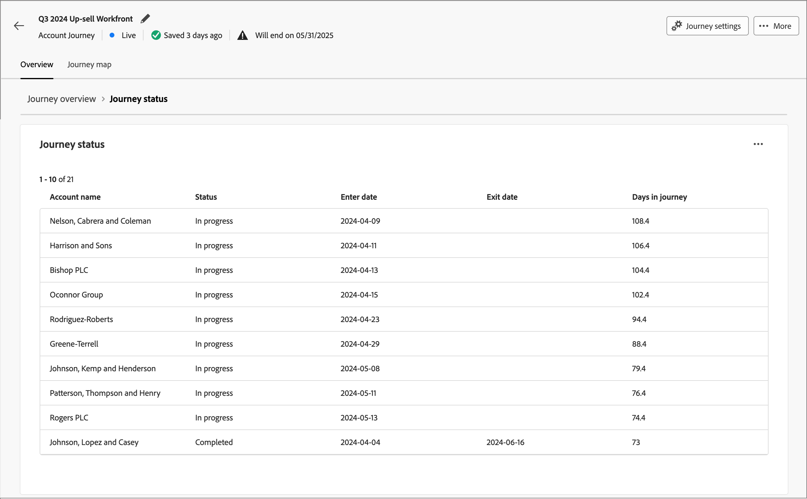

# Journey-Details

Öffnen Sie [!DNL Adobe Journey Optimizer B2B Edition] eine veröffentlichte Konto- oder Personen-Journey und wählen Sie die Registerkarte **[!UICONTROL Übersicht]** aus. Überprüfen Sie den Fortschritt, die Interaktion und die Kanalleistung für die ausgewählte Journey.

Account Journey zeigen den Fortschritt für Accounts an. Personen-Journey zeigen den Fortschritt für Personen an. Die verfügbaren Widgets und Metrikbeschriftungen unterscheiden sich je nach Journey-Typ. Wählen Sie die entsprechende Registerkarte für Dashboard-Details.

Verwenden Sie für E-Mail-Metriken, die in allen Journey aggregiert werden[ den E-Mail-Leistungsbericht](../dashboards/email-performance-dashboard.md).

>[!BEGINTABS]

>[!TAB Account Journey]

Das Dashboard zur Account-Journey zeigt den Account-Fortschritt, die Interaktion, die Kanal-Performance und die Zusammenfassungen der generativen KI an. Es dauert etwa vier Stunden, bis die Daten mit den Diagrammen und Tabellen beginnen.

{width="700" zoomable="yes"}

## Journey-Abschluss

Dieser Abschnitt enthält zwei Abschlussmetriken:

* **[!UICONTROL Status der Konten auf der Journey]**: Zeigt die Gesamtanzahl der Konten und eine Aufschlüsselung nach Journey-Status an, einschließlich _Abgeschlossen_, _In_ und _Abgebrochen_. Jedes Segment zeigt den Status, den Prozentsatz und die Anzahl der Konten an.
* **[!UICONTROL Abgeschlossene Konten im Zeitverlauf]**: Zeigt die Anzahl der Konten, die das Journey im Zeitverlauf abgeschlossen haben. Die horizontale Achse zeigt Datumsangaben an, die vertikale Achse die Anzahl der Konten.

>[!NOTE]
>
>In Account Journey umfasst der **[!UICONTROL Kontostatus im Journey]**-Diagramm Konten, die die Journey durchlaufen haben, auch wenn sie nachträglich gelöscht wurden. **[!UICONTROL Drillthrough]** Schließt gelöschte Konten aus, sodass weniger Datensätze angezeigt werden können als im Diagramm. Dieser Unterschied ist zu erwarten. Durch das Löschen von Konten werden die historischen Journey-Statuswerte nicht geändert.

## Journey-Interaktion

In diesem Abschnitt werden zwei Interaktionsmetriken vorgestellt:

* **[!UICONTROL Interaktion nach Konten]** - Dieses Kreisdiagramm segmentiert die Konten auf einer Journey in _Interagiert_ und _Nicht interagiert_ Kategorien. Die zentrale Zahl zeigt die Gesamtzahl an. Diese Visualisierung bietet ein schnelles Verständnis der gesamten Account-Interaktion.
* **[!UICONTROL Interaktion nach Personen]**: Zeigt die Anzahl der Personen mit Interaktionsaktivitäten auf dem Journey an. Dieser Wert zählt Menschen, nicht die Interaktionsaktivitäten.

## Journey-Performance

Dieser Abschnitt enthält zwei wichtige Metriken:

* **[!UICONTROL Journey-Abschlussrate]** - Der Prozentsatz der Konten, die ihr Journey erfolgreich abgeschlossen haben.
* **[!UICONTROL Durchschnittliche Journey-Abschlusszeit]**: Die durchschnittliche Zeit, die Konten zum Abschließen der Journey benötigt haben, angezeigt in Tagen.

## Kanalleistung {#email-and-sms-performance}

Das Dashboard enthält die **[!UICONTROL E]** Mail-Performance **[!UICONTROL , SMS-Performance]** und **[!UICONTROL WhatsApp-]** für die ausgewählte Account-Journey. Verwenden Sie die verfügbaren Versand- und Interaktionsmetriken, um jeden Kommunikations-Touchpoint zu bewerten.

**[!UICONTROL E-Mail]** Leistung) Tabellenspalten:

* _[!UICONTROL Asset-]_: Name des Assets
* _[!UICONTROL Gesendet]_ - Anzahl der gesendeten E-Mails
* _[!UICONTROL Versandrate]_ - Anzahl der zugestellten E-Mails dividiert durch die gesendete Anzahl
* _[!UICONTROL Öffnungsrate]_ - Anzahl der geöffneten E-Mails dividiert durch die Anzahl der zugestellten Nachrichten
* _[!UICONTROL Klickrate]_ - Anzahl der angeklickten E-Mails dividiert durch die Anzahl der zugestellten Nachrichten

**[!UICONTROL SMS-Leistung]** Tabellenspalten:

* _[!UICONTROL Asset-]_: Name des Assets
* _[!UICONTROL Gesendet]_ - Anzahl der gesendeten SMS-Nachrichten
* _[!UICONTROL Versandrate]_ - Anzahl der zugestellten SMS-Nachrichten dividiert durch die Anzahl der gesendeten Nachrichten
* _[!UICONTROL Klickrate]_ - Anzahl der angeklickten SMS-Nachrichten dividiert durch die Anzahl der zugestellten Nachrichten
<!--
To generate a shareable PDF of your current view, click **[!UICONTROL Export]** at the top right of the page. 
-->

## Zusätzliche Aktionen

Verwenden Sie das Menü **…** für ein Diagramm oder eine Tabelle, um auf die verfügbaren Aktionen zuzugreifen.

### Drill-Through

Wählen Sie für **[!UICONTROL Kontostatus im Journey]**-Diagramm **[!UICONTROL Drill-Through]** für eine detaillierte Analyse der einzelnen Kontostatus aus.

{width="600" zoomable="yes"}
<!--
The applied global filters are carried over to the view and displayed at the top. Click the _Filter_ icon at the top left to filter the data display by journey.
-->

### Mehr anzeigen

Wählen Sie **[!UICONTROL Mehr anzeigen]**, um auf erweiterte Daten zuzugreifen. Das angezeigte Popup bietet eine Aufschlüsselung der Daten.

{width="600" zoomable="yes"}

Um die Daten herunterzuladen, wählen Sie **[!UICONTROL CSV herunterladen]** aus. Um zum Dashboard _[!UICONTROL Übersicht]_ zurückzukehren, wählen Sie **[!UICONTROL Schließen]** aus.

>[!TAB Personen-Journey ]

Das Dashboard für Personen-Journey zeigt Fertigstellung, Interaktion und E-Mail-Leistung für Personen auf der ausgewählten Journey an.

{width="700" zoomable="yes"}

## Journey-Abschluss {#person-journey-completion}

Verwenden Sie die folgenden Diagramme, um den Status der Personen im Journey und die Abschlusstrends zu überprüfen:

* **[!UICONTROL Status der Personen auf der Journey]**: Zeigt die Gesamtzahl der Personen und eine Aufschlüsselung nach Journey-Status. Jedes Segment zeigt den Status, den Prozentsatz und die Anzahl der Personen an.
* **[!UICONTROL Abgeschlossene Personen im Zeitverlauf]**: Zeigt die Anzahl der Personen, die die Journey im Zeitverlauf abgeschlossen haben. Die Reihe **[!UICONTROL Inkrementell abgeschlossen]** zeigt für jedes Zeitintervall Abschlüsse an. Die Reihe **[!UICONTROL Kumulativ abgeschlossen]** zeigt die laufende Gesamtzahl der Abschlüsse an.

>[!NOTE]
>
>Bei Personen-Journey enthält der **[!UICONTROL Status von Personen im Journey]**-Diagramm Personen, die die Journey durchlaufen haben, auch wenn sie anschließend gelöscht wurden. **[!UICONTROL Drillthrough]** Schließt gelöschte Personen aus, sodass weniger Datensätze angezeigt werden können als im Diagramm. Dieser Unterschied ist zu erwarten. Durch das Löschen von Personen werden die historischen Journey-Statuswerte nicht geändert.

Klicken Sie unter _[!UICONTROL Status von Personen im Journey]-Diagramm auf das Symbol_ Mehr_ ( **…** ) und wählen Sie **[!UICONTROL Drill-Through]** aus, um den Status einzelner Personen zu überprüfen.

## Journey-Interaktion {#person-journey-engagement}

Das Widget **[!UICONTROL Interaktion nach Personen]** zeigt die Anzahl der Personen mit Interaktionsaktivitäten auf dem Journey an. Dieser Wert zählt Menschen, nicht die Interaktionsaktivitäten.

## Journey-Performance {#person-journey-performance}

Verwenden Sie die folgenden Metriken, um die Abschlussleistung zu überprüfen:

* **[!UICONTROL Journey-Abschlussrate]**: Der Prozentsatz der Personen, die die Journey abgeschlossen haben.
* **[!UICONTROL Durchschnittliche Journey-Abschlusszeit]**: Die durchschnittliche Zeit, die Personen zum Abschließen der Journey benötigt haben, angezeigt in Tagen.

## E-Mail-Leistung {#person-journey-email-performance}

Die **[!UICONTROL E-Mail-Leistung]**-Tabelle zeigt die Zahlen für jedes E-Mail-Asset auf der ausgewählten Personen-Journey anstelle der Raten an:

* **[!UICONTROL Asset-]**: Name des E-Mail-Assets
* **[!UICONTROL Gesendet]**: Anzahl der gesendeten E-Mails
* **[!UICONTROL Zugestellt]**: Anzahl der zugestellten E-Mails
* **[!UICONTROL Geöffnet]**: Anzahl der geöffneten E-Mails
* **[!UICONTROL geklickt]**: Anzahl der angeklickten E-Mails

>[!ENDTABS]
