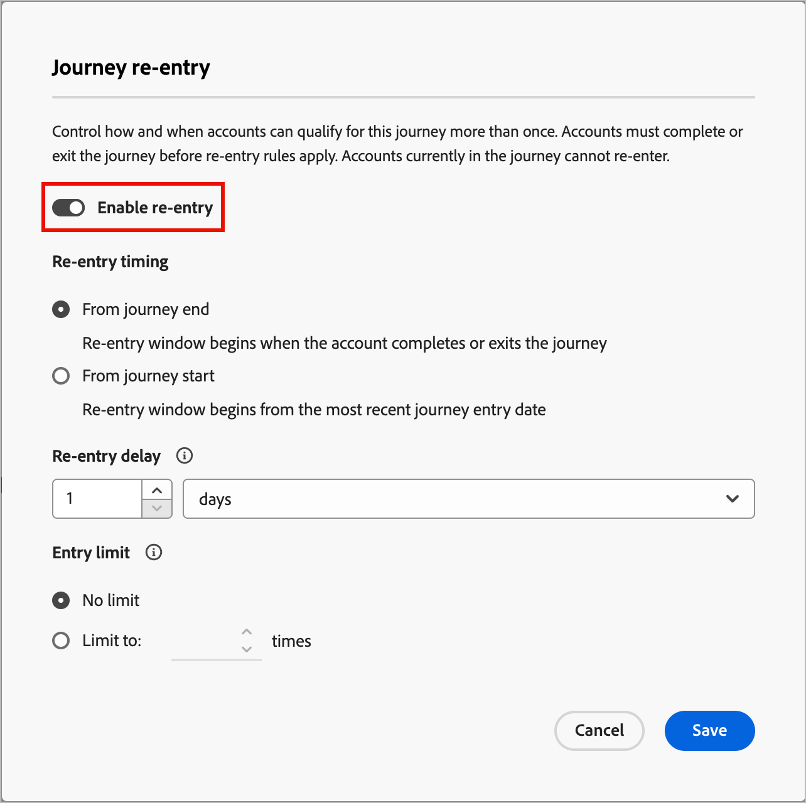

# Journey-Wiedereintritt

Wenn Sie die erneute Eingabe für eine Journey aktivieren, können Sie festlegen, wann und wie oft ein Account oder eine Person dieselbe Journey erneut betreten kann. Verwenden Sie die Einstellungen für den erneuten Eintritt, um Kriterien, Beschränkungen und Wartezeiten festzulegen, damit sich Accounts oder Personen kontrolliert für den Journey qualifizieren.

Ein Konto oder eine Person kann sich erneut für eine Journey qualifizieren, wenn die folgenden Punkte zutreffen:

* Das Konto oder die Person liegt innerhalb der Anzahl der zulässigen erneuten Einträge für die Journey.
* Das Konto oder die Person hat den Wartezeitschwellenwert (die Mindestwartezeit vor der erneuten Qualifizierung) erreicht.
* Das Konto oder die Person befindet sich derzeit nicht auf der Journey.

## Erneutes Einlesen für eine Journey aktivieren

Sie können die Wiedereinstiegseinstellungen aktivieren und die Wiedereinstiegseinstellungen ändern, wenn sich die Journey im Status _Entwurf_ befindet.

>[!BEGINTABS]

>[!TAB Konto-Journey]

1. Öffnen Sie die Journey des Kontoentwurfs.

1. Klicken Sie oben rechts auf **[!UICONTROL Mehr…]** und wählen Sie **[!UICONTROL Wiedereintritt]**.

   {width="450"}

1. Schalten Sie im Dialogfeld für den erneuten _von_ Journey die Option **[!UICONTROL Erneuten Eintrag aktivieren]** um.

   Wenn die Funktion aktiviert ist, werden die Optionen für Timing, Verzögerung und Grenzwerte angezeigt.

   {width="450"}

1. Wählen **[!UICONTROL für die Zeitplanung]** erneuten Eintritt die Art der Wartezeit:

   * **[!UICONTROL Warten ab Ende der Journey]** - Die Wartezeit beginnt, wenn das Konto beendet wird oder die Journey abschließt. Beispiel: „30 Tage, nachdem das Konto die Journey abgeschlossen hat, kann es erneut eingeben.“

   * **[!UICONTROL Warten ab dem Start des Journey]** - Die Wartezeit basiert darauf, wann das Konto zum ersten Mal auf die Journey zugegriffen hat. Beispiel: „30 Tage nach dem Start des Journey durch das Konto kann es erneut eingegeben werden.“

1. Legen Sie die **[!UICONTROL Wiedereinstiegsverzögerung]** fest, d. h. die Wartezeit in Stunden oder Tagen.

   Diese Einstellung legt fest, wie lange ein Konto nach dem Beenden oder Starten der Journey warten muss, bevor es erneut eintreten kann.

1. Um festzulegen, wie oft ein Konto maximal auf die Journey zugreifen darf, legen Sie **[!UICONTROL Einstiegslimit]** fest.

   Wenn ein Konto das Limit erreicht, ist es nicht mehr für die Eingabe qualifiziert, bis das Limit zurückgesetzt oder die Journey mit einem neuen Limit erneut veröffentlicht wurde.

   Dieser Grenzwert gilt pro Konto für diese Journey.

1. Klicken Sie auf **[!UICONTROL Speichern]**.

>[!TAB Personen-Journey]

1. Öffnen Sie die Journey der Entwurfsperson.

1. Klicken Sie oben rechts auf das **[!UICONTROL Mehr…]** und wählen Sie **[!UICONTROL Einstellungen erneut eingeben]**.

   {width="450"}

1. Schalten Sie im Dialogfeld für den erneuten _von_ Journey die Option **[!UICONTROL Erneuten Eintrag aktivieren]** um.

   Wenn die Funktion aktiviert ist, werden die Optionen für Timing, Verzögerung und Grenzwerte angezeigt.

   {width="450"}

1. Wählen **[!UICONTROL für die Zeitplanung]** erneuten Eintritt die Art der Wartezeit:

   * **[!UICONTROL Warten ab Ende des Journey]** - Die Wartezeit beginnt, wenn die Person die Journey verlässt oder abschließt. Zum Beispiel: „30 Tage, nachdem die Person die Journey abgeschlossen hat, kann sie erneut eintreten.“

   * **[!UICONTROL Warten ab Beginn des Journey]** - Die Wartezeit basiert darauf, wann die Person die Journey zum ersten Mal betreten hat. Beispiel: „30 Tage nach dem Start der Journey kann die Person erneut eintreten.“

1. Legen Sie die **[!UICONTROL Wiedereinstiegsverzögerung]** fest, d. h. die Wartezeit in Stunden oder Tagen.

   Diese Einstellung legt fest, wie lange eine Person nach dem Beenden oder Starten der Journey warten muss, bevor sie erneut eintreten kann.

1. Um festzulegen, wie oft eine Person die Journey betreten darf, legen Sie das **[!UICONTROL Eintrittslimit]** fest.

   Wenn eine Person das Limit erreicht, ist sie nicht mehr für die Eingabe qualifiziert, bis das Limit zurückgesetzt oder die Journey mit einem neuen Limit erneut veröffentlicht wurde.

   Dieser Grenzwert gilt pro Person für diese Journey.

1. Klicken Sie auf **[!UICONTROL Speichern]**.

>[!ENDTABS]

## Verlauf und Aktivität

Bei veröffentlichten Konto- oder Personen-Journey wird auf der Journey-Arbeitsfläche [Progression](./journeys-overview.md#review-account-progression) für die Journey-Knoten angezeigt. In jedem Knoten wird die Anzahl der Konten oder Personen angezeigt, die diesen Knoten erreichen, sowie bei Live-Journey die aktuelle Anzahl an diesem Knoten. Jedes Mal, wenn ein Konto oder eine Person eine Journey erneut betritt, zählt dies als eigenständiger Eintrag.

<!-- 
You can see how many times accounts have entered the journey. ?? 

When you drill in to [account details](../accounts/account-details.md), the account activity shows each time the account entered the journey. It includes explicit activity and a recurrence count so that you can see re-entries clearly.
-->
