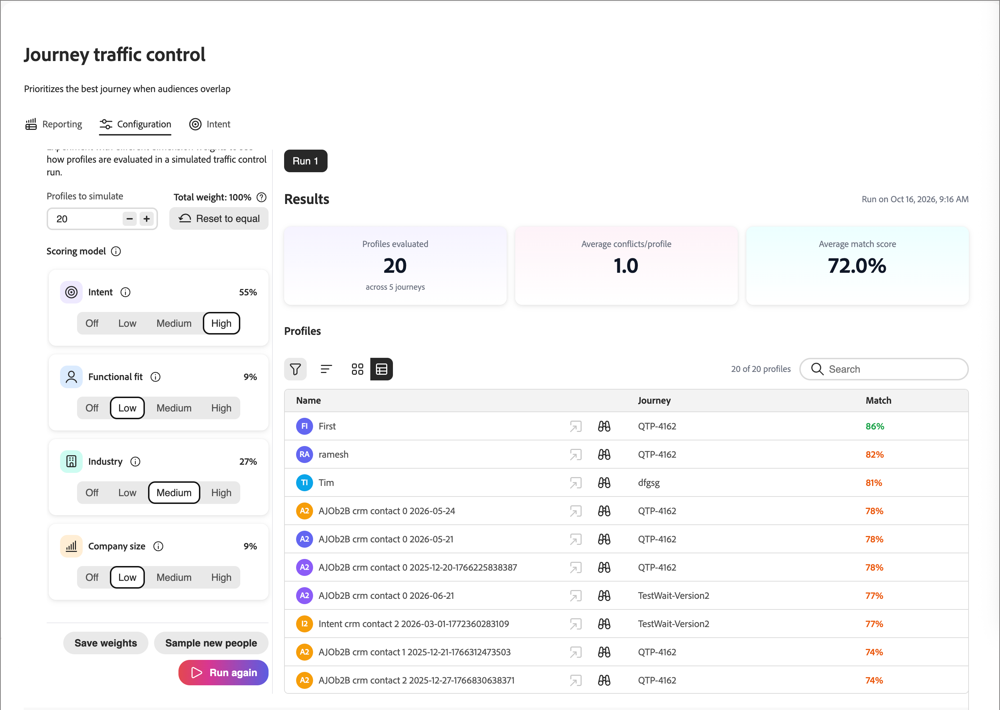

# Journey-Traffic-Steuerung

[!DNL Adobe Journey Optimizer B2B Edition] überschneiden sich Zielgruppen häufig. Ein Marketingleiter einer Finanzdienstleistungsfirma könnte sich noch am selben Tag für Ihre Branchen-Journey, Ihre Produkt-Journey und Ihre Enterprise-Account-Journey qualifizieren. Ohne Koordinierung ist diese Person in allen drei Ländern eingeschrieben und erhält konkurrierende oder redundante Nachrichten. Verwenden Sie die _Journey-Traffic_-Steuerung, um jede Person für die Personen-Journey zu registrieren, die am besten zu ihr passt, wenn sie sich gleichzeitig für mehr als eine Journey qualifizieren.

Die Traffic-Kontrolle für Journey überprüft jede Person, die sich für mehr als einen teilnehmenden Journey qualifiziert. Es vergleicht, was Sie über die Person wissen, mit jedem Journey-Zweck, und registriert die Person in der besten Übereinstimmung. Eine Person, die nur für eine Journey qualifiziert ist, wird für diese Journey registriert. Eine Person, die sich für „Keine“ qualifiziert, ist nicht registriert.

## Vorteile der Journey-Traffic-Steuerung {#benefits}

Journey-Traffic-Control ersetzt das manuelle Überschneidungs-Management durch eine aufgezeichnete, passgenaue Entscheidung für jede Person.

| Ohne Journey-Traffic-Steuerung | Mit Journey-Traffic-Steuerung |
|---|---|
| Eine Person, die mit mehreren Audiences übereinstimmt, wird in mehreren Journey registriert und erhält überlappende Nachrichten. | Jede Person wird für jede Auswertung in höchstens eine teilnehmende Journey aufgenommen. |
| Teams verwalten Überschneidungen manuell mit Ausschlusssegmenten und Zielgruppenregeln. Diese Regeln sind mit jeder neuen Journey schwieriger zu pflegen. | Das System wählt basierend auf der Passform. Ausschlusslogik wird weder erstellt noch verwaltet. |
| Es ist schwer zu erklären, warum eine Person eine bestimmte Journey erhalten hat. | Jede Entscheidung wird aufgezeichnet und sichtbar, einschließlich der Punktzahl für jede konkurrierende Journey. |
| Die Ermüdung von Nachrichten und das gemischte Messaging reduzieren die Interaktion. | Jede Person erhält ein relevantes, konsistentes Erlebnis. |

## Anwendungsbeispiele {#examples}

Verwenden Sie die Journey-Traffic-Steuerung, wenn Ihre Journey sich überschneidende Zielgruppen ansprechen. Beispiel:

* **Industry Nurture-Programme**: Sie betreiben separate Journey für Finanzdienstleistungen, Gesundheitswesen und Produktion. Ein Kontakt hat keinen Branchenwert, aber sein Profil ist mit dem Konto einer Bank verknüpft. Die Journey-Traffic-Steuerung gleicht den Kontakt mit der Financial Services-Journey ab, anstatt sie in allen drei zu registrieren.
* **Produktinteressenskampagnen**: Sie führen für jede Produktlinie eine Journey aus. Ein Interessent mit aktuellen Interessenssignalen für zwei Produkte wird in die Journey für das Produkt mit dem größten Interesse aufgenommen.
* **Rollenbasiertes Messaging**: Sie führen eine Journey für technische Gutachter und eine andere für Executive-Sponsoren aus. Berufsbezeichnung und Funktion einer Person entscheiden, welcher Journey sie beitritt.
* **Enterprise- und SMB** Programme: Je nach Unternehmensgröße werden unterschiedliche Journey-Programme ausgeführt. Das Kundensegment und die Kontoinformationen eines Kontakts entscheiden, welcher Journey sie beitreten.
* **Neue Journey-Launches**: Sie veröffentlichen eine neue Journey in einer Zielgruppe, die bereits von anderen Journey abgedeckt wird. Die Journey-Traffic-Steuerung wertet die Überschneidung aus, sodass Sie bestehende Zielgruppenregeln nicht neu gestalten.

## Auswahl nach Anpassen {#dimensions}

Wenn sich eine Person für mehr als eine Journey qualifiziert, vergleicht die Journey-Traffic-Steuerung das Profil der Person mit dem Namen und der Beschreibung jeder Journey. Der Vergleich deckt vier Dimensionen ab.

| Dimension | Was wird verglichen |
|---|---|
| Branche | Die Branche der Person. Wenn die Branche fehlt, die Branche des verknüpften Kontos. |
| Funktionale Anpassung | Rolle und Funktion der Person. |
| Unternehmensgröße | Kundensegment, Kontotyp und Ausgabenkontext der Person. |
| Absicht | Das Produkt, für das die Person zuletzt das größte Interesse gezeigt hat. |

Beachten Sie die folgenden Punkte:

* **Journey-Namen und -Beschreibungen sind wichtig.** Sie sagen dem System, wofür jede Journey geeignet ist. Spezifische, genaue Beschreibungen führen zu besseren Übereinstimmungen.
* **Fehlende Daten werden übersprungen, nicht erraten.** Wenn eine Person keinen Wert für eine Dimension hat, lässt die Journey-Traffic-Steuerung diese Dimension für diese Person unberücksichtigt. Er entscheidet über die Dimensionen, die Daten haben.

Der Entscheidungsdatensatz für jede Person in den Berichtsansichten zeigt die Bewertung für jede konkurrierende Journey und die verwendeten Dimensionen an. Eine Dimension ohne Daten wird als ausgeschlossen markiert.

### Vergleiche {#comparisons}

Für jede Dimension vergleicht die Journey-Traffic-Steuerung den relevanten Text der Person, z. B. die Stellenbezeichnung, mit der jeweiligen Journey-Beschreibung. Es werden zwei Methoden verwendet:

* **Bedeutung Ähnlichkeit**: Bedeutet der Text etwas, das der Beschreibung nahekommt?
* **Keyword-Matching**: Verwendet der Text dieselben Begriffe wie die Beschreibung?

Das bessere Ergebnis der beiden Methoden wird zum Journey-Wert für diese Dimension.

Jede Dimension schlägt dann ihren Journey mit der besten Bewertung vor, jedoch nur, wenn der Wert einen Mindestqualitätsschwellenwert überschreitet. Journey ohne qualifizierenden Vorschlag werden fallen gelassen. Die Gewichtungen, die Sie konfigurieren, ordnen die verbleibenden Journey nach ihren kombinierten gewichteten Werten. Die Journey mit der höchsten Punktzahl ist ausgewählt. Gewinner ist nicht unbedingt die Journey mit den meisten Vorschlägen. Eine starke Übereinstimmung bei einer Dimension ist wichtiger als mehrere schwächere Übereinstimmungen.

Jeder Entscheidungsdatensatz speichert die folgenden Informationen:

* Die ausgewählte Journey und die konkurrierenden Journey
* Die Bewertungen für jede Dimension und die kombinierte Bewertung
* Ein Konfidenzwert
* Eine Vereinbarungsebene von Hoch, Medium oder Niedrig, die angibt, wie viele Dimensionen den Gewinner unterstützt haben

<!-- CONFIRM with Engineering: whether to describe the fallback when no dimension produces a qualifying match. The source says the person is still enrolled in one eligible journey, selected consistently, with a 0% (Low) confidence decision record. Also confirm how "consistent" should be phrased. -->

## Konfiguration {#configuration}

So legen Sie die Gewichtung der Journey-Traffic-Steuerungsdimension fest und simulieren die Bewertung:

1. Navigieren Sie im linken Navigationsbereich zu **[!UICONTROL Journey-Verwaltung]** > **[!UICONTROL Journey-Traffic-Steuerung]**.

1. Wählen Sie die **[!UICONTROL Konfiguration]** aus.

{width="800" zoomable="yes"}

### Anpassen der Dimensionsgewichte {#weights}

Standardmäßig haben alle vier Dimensionen eine Gewichtung von _Medium_ und leisten mit jeweils 25 % einen gleichen Beitrag. Passen Sie die Gewichtungen an, um zu ändern, wie stark jede Dimension Entscheidungen beeinflusst.

1. Legen Sie für jede Dimension die Gewichtungsstufe fest:

   * **[!UICONTROL Aus]**
   * **[!UICONTROL Niedrig]**
   * **[!UICONTROL Medium]**
   * **[!UICONTROL Hoch]**

   Der Prozentsatz auf jeder Karte zeigt den Anteil dieser Dimension an, nachdem Ihre Einstellungen kombiniert wurden. Um eine Dimension aus Entscheidungen zu entfernen, setzen Sie sie auf **[!UICONTROL Aus]**.

   {width="600"}

   Der auf jeder Karte angezeigte Prozentsatz entspricht dem normalisierten Beitrag dieser Dimension, nachdem alle Ihre Auswahlen kombiniert wurden, immer insgesamt 100 %. Wenn Sie eine Dimension anheben, normalisiert das System die anderen automatisch neu, sodass die Gesamtsumme bei 100 % bleibt.

   Sie können auf **[!UICONTROL Auf Gleich zurücksetzen]** klicken, um alle Dimensionen auf eine gleichmäßige Gewichtung zurückzusetzen.

1. Wenn Sie die angepassten Gewichtungen anwenden möchten, wählen Sie **[!UICONTROL Gewichtungen speichern]**.

   >[!NOTE]
   >
   >Um Änderungen an den Dimensionsgewichten zu speichern, benötigen Sie die Berechtigung _[!UICONTROL B2B-Admin-Konfigurationen verwalten]_ [Produktberechtigung](../admin/user-management.md#b2b-product-permissions).

### Scoring simulieren {#simulate-scoring}

Bevor Sie Gewichtungen an die Produktion übergeben, können Sie simulieren, wie sich die Traffic-Steuerung bei diesen Änderungen verhält. Bei der Simulation muss die Journey-Traffic-Steuerung nicht aktiviert sein. Profile, die sich bereits in Ihren Live-Journey befinden, werden ausgewertet und die Traffic-Steuerungslogik wird auf sie angewendet. Dann können Sie beurteilen, ob die Ergebnisse für die Gewichtungseinstellungen richtig aussehen.

Klicken Sie auf **[!UICONTROL Bewertung simulieren]**.

Die Ergebniskopfzeile fasst den Durchlauf zusammen:

* **Ausgewertete Profile** - Wie viele Profile wurden ausgewertet, und über wie viele Journey hinweg.
* **Durchschnittliche Konflikte/**: Die durchschnittliche Anzahl konkurrierender Journey pro Profil.
* **Durchschnittlicher Übereinstimmungswert** - Die durchschnittliche Konfidenz der ausgewählten Journey.

{width="700" zoomable="yes"}

Jedes ausgewertete Profil wird als Karte angezeigt, die die ausgewählte Journey, die Schlüsselargumente, die Absichtssignale und die Übereinstimmungsbewertung enthält. Wählen Sie ein Profil aus, um eine Detailansicht zu öffnen mit:

* **Übereinstimmungswert** - Die Gesamtübereinstimmung mit einer farbcodierten Aufschlüsselung nach Dimension.
* **Werte nach Journey** - Die Journey, für die sich diese Person qualifiziert hat, welche ausgewählt wurde und warum.
* **Berücksichtigte Dimensionen** - Die Dimensionsdaten, die die Entscheidung vorantrieben, erweiterbar, um die zugrunde liegenden Signale anzuzeigen.

{width="450" zoomable="yes"}

Passen Sie bei Bedarf die Bemaßungsgewichte an und klicken Sie auf **[!UICONTROL Erneut ausführen]**, um die Simulation erneut auszuführen.

Sie können auch auf **[!UICONTROL Neue Personen abfragen]** klicken, um die Simulation mit einer neuen Stichprobe erneut auszuführen.

Wenn Sie mit dem Ergebnis zufrieden sind, können Sie auf **[!UICONTROL Gewichtungen speichern]** klicken, um die Gewichtungen zu bestätigen. Neue Entscheidungen zur Traffic-Steuerung verwenden die neuen Einstellungen sofort, frühere Entscheidungen sind davon jedoch nicht betroffen. Die von Ihnen getesteten Gewichtungen werden auf der Registerkarte _[!UICONTROL Konfiguration]_ angezeigt und werden für alle Journey-Traffic-Steuerelemente verwendet, die in Ihrer Live-Umgebung ausgewertet werden.

Sie können die Seite auch verlassen, ohne die Gewichtungen anzuwenden.

## Berichte überprüfen {#reporting}

Verwenden Sie die Berichtsansichten, um zu sehen, wie Journey Traffic Control Personen registriert hat. Überprüfen Sie Entscheidungen per Journey oder Ausführung.

### Berichterstellung nach Journey {#reporting-by-journey}

Die **[!UICONTROL By Journey]**-Ansicht fasst die Journey unter Traffic-Steuerung zusammen.

| Metrik | Beschreibung |
|---|---|
| Journey | Journey, die an der Verkehrssteuerung beteiligt sind. |
| Angefochtene Journey | Journey, die Personen mit mindestens einer anderen Journey teilen. |
| Angefochtene Profile | Unterschiedliche Personen, die von zwei oder mehr Journey beansprucht werden. |
| Personen registriert | Unterschiedliche Personen registriert. |

Für jede Journey zeigt die Ansicht auch die folgenden Werte an:

* **[!UICONTROL Enrolled]**: Die Gesamtzahl der registrierten Personen.
* **[!UICONTROL Unangefochten]**: Personen, die sich nur für diese Journey qualifiziert haben.
* **[!UICONTROL Gewonnen]**: Personen, die sich für mehrere Journey qualifiziert haben und in diesem eingeschrieben waren.
* **[!UICONTROL Erfolgsquote]** Wie oft die Journey gewonnen hat, als Menschen darum wetteiferten.

{width="700" zoomable="yes"}

Filtern Sie die Liste nach [Journey](./journeys-overview.md#journey-status)Status: [!UICONTROL Live], [!UICONTROL Finished], [!UICONTROL Abgebrochen] oder [!UICONTROL All].

Um zu sehen, wo die umkämpften Leute einer Journey gelandet sind, öffnen Sie die Journey. Die Detailansicht zeigt die Journey an, für die die Personen stattdessen registriert waren. Erweitern Sie zum Anzeigen der Übereinstimmungsbewertung, der konkurrierenden Journey-Werte, der Bewertung für jede Person und der verwendeten Dimensionen den Entscheidungsdatensatz einer beliebigen registrierten Person. Suche nach Name, Lead-ID oder Profil-ID.

{width="700" zoomable="yes"}

Um zu vergleichen, wie sich Branchen- oder Absichtsprodukte auf Journey verteilen, wählen Sie **[!UICONTROL Journey vergleichen]** und wählen Sie mindestens zwei und bis zu 20 Live-Journey aus.

<!-- Figure placeholders: By Journey overview, journey detail "Where contested profiles landed", and a decision record. Redact person names and use clean sample journey names without test prefixes. Choose runs with healthy enrollment counts. -->

### Reporting nach Ausführung {#reporting-by-run}

Wählen Sie **[!UICONTROL Nach Ausführung]** aus, um eine Liste jedes Auswertungsdurchgangs mit den folgenden Informationen anzuzeigen:

* Die Zeit des Durchgangs
* Wie die Ausführung ausgelöst wurde: *Geplant*, *Bei Veröffentlichung* oder *Manuell*
* Die Anzahl der evaluierten, registrierten und nicht registrierten Personen

{width="700" zoomable="yes"}

Filtern Sie die Liste nach Zeitbereich (24 Stunden, 7 Tage, 30 Tage oder alle Zeiten) und Trigger-Typ.

Öffnen Sie einen Durchlauf, um ein Flussdiagramm der evaluierten Personen zu den Journey anzuzeigen, für die sie registriert waren. Eine Aufschlüsselung für jede Journey zeigt, wie viele Personen **[!UICONTROL Nicht registriert]**, ****, **[!UICONTROL Schiedsrichter]** (unter konkurrierenden Journey ausgewählt) und **[!UICONTROL Nicht angefochten]**. Bei jedem Journey in einem Durchlauf können Sie auch die bewerteten Personen, ihre Ergebnisse, die Journey, mit denen sie angetreten sind, und ihre Übereinstimmungsbewertungen anzeigen.

{width="500" zoomable="yes"}

<!-- CONFIRM with Product: what the scheduled and on-publish triggers mean for customers, and the content of the Not enrolled tooltip. -->

## Ausführungsprozess der Auswertung {#run-process}

Jeder Durchgang folgt derselben Sequenz. Die Journey-Traffic-Steuerung liest nur Daten, die bereits in Ihrer [!DNL Journey Optimizer B2B Edition] vorhanden sind, und erfordert keine zusätzlichen Datenquellen.

1. Die Journey-Traffic-Steuerung wartet darauf, dass die Person und [ Konto (](../data/data-availability-timing.md#daily-refresh)) in Ihrer Umgebung erfolgreich abgeschlossen werden. Wenn die Aktualisierung fehlschlägt, wird kein Durchlauf mit veralteten Daten gestartet.

1. Die Zielgruppenzugehörigkeit wird in [!DNL Adobe Experience Platform] berechnet und [synchronisiert](../data/data-availability-timing.md#platform-sync) um [!DNL Journey Optimizer B2B Edition]. Nach Abschluss der Segmentierung wartet das System bis zu 30 Minuten auf den Abschluss der Synchronisierung. Wenn die Synchronisierung früher abgeschlossen ist, beginnt die Verarbeitung sofort. Wenn zuerst 30 Minuten vergehen, beginnt die Verarbeitung trotzdem. Wenn die Synchronisierung später abgeschlossen wird, beginnt ein neuer Durchlauf mit den aktualisierten Daten.

1. Das System stellt die Journey zusammen. Nur Journey, die live und für die Traffic-Steuerung aktiviert sind, nehmen teil. Das System liest den Status, den Namen und die Beschreibung jeder Journey.

1. Das System liest die Zielgruppenzugehörigkeit und den Profilkontext in kleinen Batches.

1. Das System prüft die Eignung. Eine Person ist nur dann für eine Journey geeignet, wenn alles Folgende zutrifft:

   * Die Journey ist live und für die Traffic-Steuerung aktiviert.
   * Die Person ist derzeit Mitglied der Zielgruppe der Journey.
   * Die Person wurde noch nicht erfolgreich für diese Journey registriert.
   * Die Person ist derzeit nicht in dieser Journey registriert.

1. Das System wählt eine Journey aus. Eine Person mit einer geeigneten Journey ist darin registriert. Eine Person ohne geeignete Journey ist nicht registriert. Bei einer Person mit mehreren zulässigen Journey vergleicht das System das Profil der Person mit jedem Journey-Namen und jeder Beschreibung über die [vier Dimensionen](#dimensions).

1. Das System übermittelt die Registrierung an die ausgewählte Journey über den standardmäßigen Journey-Registrierungsmechanismus.

1. Das System speichert alle Entscheidungen und Registrierungsergebnisse für Berichte und Prüfungen.

1. Das System prüft den Fortschritt der Batches, zeichnet das Ergebnis auf und sendet eine Benachrichtigung über den Abschluss.

## Verwendete und gespeicherte Daten {#data}

Die Journey-Traffic-Steuerung verwendet die folgenden Daten aus Ihrer Umgebung.

| Daten | Quelle | Verwenden |
|---|---|---|
| Journey-Status, Name und Beschreibung | Ihre Journey | Entscheiden Sie, welche Journey teilnehmen und zu welchem Zweck jede Journey erhältlich ist. |
| Zielgruppenzugehörigkeit | [!DNL Experience Platform] in [!DNL Journey Optimizer B2B Edition] synchronisierte Zielgruppen | Identifizieren Sie, wer sich für jede Journey qualifiziert. |
| Personenprofil, z. B. Branche, Stellenbezeichnung und Funktion sowie Kundensegment | Personendaten | Stellen Sie die Dimensionen Branche, funktionale Anpassung und Unternehmensgröße bereit. |
| Verknüpftes Kontoprofil, wie Branche und Kontotyp | Ihre Kontodaten | Füllen Sie die Branche aus, wenn der eigene Wert der Person fehlt, und geben Sie den Kontext für das Konto an. |
| Produktinteresse | Ihre [-Daten](../admin/intent-data.md) | Geben Sie die Dimension Intent an. Es wird das Produkt mit dem stärksten und aktuellsten Interesse verwendet. |
| Registrierungsverlauf | Von vorherigen Durchgängen geschriebene Datensätze | Vermeiden Sie es, dieselbe Person wiederholt für denselben Journey zu registrieren. |
| Aktueller Registrierungsstatus | [!DNL Journey Optimizer B2B Edition] | Vermeiden Sie es, eine Person zu registrieren, die sich bereits auf der Journey befindet. |

Bei jedem Durchlauf speichert die Journey-Traffic-Steuerung eine Zusammenfassung des Durchlaufs. Für jede registrierte Person wird ein Registrierungsentscheidungsdatensatz gespeichert. Beide werden in den von Adobe verwalteten Datenspeichern Ihrer Umgebung gespeichert. Sie unterstützen die Berichte und verhindern wiederholte Registrierungen.

<!-- 
CONFIRM with Engineering, Security, and Legal before publishing. The source material does not state any of the following data handling commitments:
- Where processing occurs and data residency.
- Whether meaning similarity comparison uses a third-party or externally hosted AI service, and whether profile text leaves the Adobe environment.
- Whether customer data is used to train models shared with other customers.
- The retention period for decision and enrollment records, and how they are deleted when a person is erased (link to privacy requests).
- Encryption in transit and at rest, role-based access to the reports, and tenant isolation. 
-->

## Einrichten der Journey-Traffic-Steuerung {#setup}

Sie können die Journey-Traffic-Steuerung direkt auf einer individuellen [Personen-Journey](./create-publish-journey.md) aktivieren, wenn sie sich im _Entwurf_ befindet.

1. Stellen Sie sicher, dass die Personen-Journey einen Namen und eine Beschreibung hat, die einen eindeutigen Zweck und ein klares Ziel für die Journey bieten.

   Diese Namen und Beschreibungen sind die Grundlage für die Zuordnung.

1. Klicken Sie auf **[!UICONTROL … Mehr]** oben rechts auf der Journey-Arbeitsfläche und wählen Sie **[!UICONTROL Traffic-Steuerungseinstellungen für Journey]**.

   {width="400"}

1. Aktivieren Sie im Dialogfeld die Option **[!UICONTROL Journey-Traffic-Steuerung aktivieren]**.

   Im Einstellungsdialogfeld wird das Verhalten erläutert: Wenn aktiviert, wird die Journey zu einem Kandidaten, und das Modell bewertet und empfiehlt die am besten geeignete Journey für eine Person, die sich für mehrere aktive Journey qualifiziert.

   {width="450"}

   >[!IMPORTANT]
   >
   >Der Umschalter kann jederzeit geändert werden, während die Journey im Status _Entwurf_ verbleibt. Nach dem Veröffentlichen der Journey mit aktivierter Journey-Traffic-Steuerung wird der Einstieg in diese Journey ausgewertet, und Sie können die Einstellung nicht mehr deaktivieren.

1. Klicken Sie auf **[!UICONTROL Speichern]**.

1. [Veröffentlichen](./create-publish-journey.md#publish-a-journey) die Personen-Journey.

## Einschränkungen und Abhängigkeiten {#limitations}

Die folgenden Abhängigkeiten beeinflussen, wann und wie gut die Journey-Traffic-Steuerung funktioniert:

* **Zielgruppensynchronisierung**: Entscheidungen basieren auf aktuellen Zielgruppenabonnements, die von [!DNL Experience Platform] nach [!DNL Journey Optimizer B2B Edition] synchronisiert werden. Der Ausführungszeitpunkt folgt dem Abschluss der Segmentierung und Synchronisierung. Es ist kein fester Zeitplan.
* **Profilaktualisierung**: Ein Durchlauf beginnt erst, nachdem die Aktualisierung des Personen- und Kontoprofils erfolgreich war.
* **Journey-Metadaten**: Nur Live-Journey, die für die Traffic-Steuerung aktiviert sind, nehmen teil. Die Qualität der Zuordnung hängt von den Namen und Beschreibungen ab, die Sie schreiben.
* **Profilvollständigkeit**: Die Qualität hängt von den von Ihnen verwalteten Personen-, Konto- und Intent-Daten ab. Fehlende Dimensionen werden übersprungen.

Die Journey-Traffic-Steuerung weist die folgenden Einschränkungen auf:

* **Eine Journey für jede Person**: Eine Person wird für jeden Durchgang auf höchstens einer Journey registriert.
* **Auswahl garantiert keine Registrierung**: Bis zum Abschluss der Synchronisierung mit [!DNL Experience Platform] werden einige Profile möglicherweise ohne übereinstimmende Marketo-Personen-ID ausgewertet. Die Journey ist ausgewählt, aber die Registrierung ist möglicherweise nicht erfolgreich. Diese Personen werden im Bericht *Ausführung als* Nicht registriert“ angezeigt.
* **Keine Wiederholungsregistrierung**: Die Traffic-Steuerung für das Journey registriert keine Person für eine Journey, für die sie zuvor registriert war. Um Personen die Neuqualifizierung für einen Journey zu ermöglichen, verwenden Sie die [Journey-Wiedereinstiegseinstellungen](./journey-re-entry.md).
* **Nicht in Echtzeit**: Entscheidungen werden getroffen, wenn ein Durchlauf stattfindet, nicht, wenn sich ein Profil ändert.
* **Vier feste Dimensionen**: Sie können die Wichtigkeit von Branche, funktionaler Anpassung, Unternehmensgröße und Absicht anpassen, aber keine Dimensionen hinzufügen.
* **Textbasierter Abgleich**: Journey-Namen und -Beschreibungen werden mit Profiltext verglichen. Journey mit vagen, leeren oder ähnlichen Beschreibungen sind schwerer auseinanderzuhalten. Eine schwache Differenzierung der Journey kann zu niedrigen Vertrauensergebnissen führen.

Die Journey-Traffic-Steuerung entscheidet nur darüber, auf welchem geeigneten Journey eine Person registriert ist. Ihre Journey oder Zielgruppen werden dadurch nicht geändert.

<!-- CONFIRM with Product and Engineering: the maximum number of governed journeys, maximum audience size for each run, supported editions and regions, and any language limitations for text matching. -->
