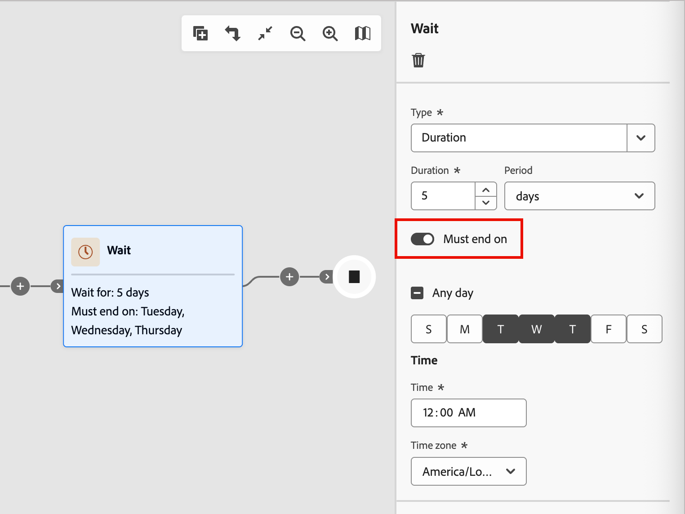

# Warteknoten

Verwenden Sie _Knoten_ Warten“, wenn Sie den Journey-Fortschritt für eine bestimmte Dauer anhalten möchten, bevor Sie mit dem nächsten Schritt fortfahren.

Es gibt zwei Möglichkeiten, die Wartezeit zu definieren:

* Ein bestimmtes Datum, an dem Sie zum nächsten Knoten auf der Journey wechseln möchten
* Eine relative Dauer (Anzahl der Minuten, Stunden, Tage, Wochen oder Monate)

## Warteknoten hinzufügen

1. Navigieren Sie zur Journey-Karte.

1. Klicken Sie auf das Pluszeichen ( **+** ) in einem Pfad und wählen Sie **[!UICONTROL Warten]** aus.

   {width="440"}

1. Um die Wartezeit festzulegen, bevor das Journey zum nächsten Knoten im Pfad fortgesetzt wird, legen Sie in den Knoteneigenschaften auf der rechten Seite den **[!UICONTROL Typ]** fest.

   * **[!UICONTROL Dauer]** - Definiert eine bestimmte Anzahl von Tagen, Stunden oder Minuten, die zwischen dem Eintritt und dem Austritt des Warteknotens vergehen sollen.
   * **[!UICONTROL Date]** - Geben Sie ein Datum und eine Uhrzeit für den Austritt an.

   {width="500"}

## Erweiterte Warteeinstellungen

Aktivieren Sie die Option **[!UICONTROL Muss enden am]**, um einen _erweiterten_&quot; zu konfigurieren und sicherzustellen, dass Ihre Nachrichten Personen und Kontomitglieder zum optimalen Zeitpunkt erreichen. Mit dieser Konfiguration können Sie genau steuern, wann eine Person oder ein Konto einen Warteschritt beendet und zum nächsten Knoten auf der Journey übergeht. Anstatt eine feste Anzahl von Stunden oder Tagen von der Ein- bis zur Ausreise zu definieren, können Sie Aktionen so planen, dass sie zu bestimmten Zeiten und an bestimmten Wochentagen stattfinden.

Mit einem _erweiterten Warteschritt_ definieren Sie **_wann_** die Person oder das Konto beendet wird, nicht einfach nur die Wartezeit.

{width="500"}

### Wartetypen

| Wartetyp | Beschreibung | Konfiguration |
| --------- | ----------- | ------------- |
| **Bestimmte Tageszeit** | Halten Sie bis zu einem bestimmten Zeitpunkt (z. B. 9:00 Uhr) | Uhrzeit (Stunde und Minute) einstellen. Beendet den Vorgang beim nächsten Vorkommen dieser Zeit (für die ausgewählte Zeitzone). |
| **Bestimmter Wochentag** | Halten Sie bis zu einem bestimmten Tag (z. B. Dienstag) | Einen Wochentag auswählen. Wenn keine Uhrzeit angegeben ist, erfolgt der Austritt um Mitternacht (für die ausgewählte Zeitzone) am nächsten übereinstimmenden Tag. |
| **Tagesbereich oder Kombination** | Anhalten bis zu einem beliebigen Tag innerhalb eines Bereichs (z. B. Montag bis Freitag) oder an einem der angegebenen Tage | Zieltage auswählen. Wenn keine Uhrzeit angegeben ist, erfolgt der Austritt um Mitternacht (für die ausgewählte Zeitzone) am nächsten übereinstimmenden Tag. |
| **Zeit + Tag-Kombination** | Kombinieren Sie beide für eine präzise Planung (z. B. Dienstag um 10:00 Uhr) | Wählen Sie Ihre Zieltage und legen Sie die Zielzeit fest. Beendet am nächsten Tag/zur nächsten Uhrzeit (für die ausgewählte Zeitzone). |

### Häufige Szenarien

Die folgenden Szenarien veranschaulichen, wie Sie typische Beispiele auf Ihre Warteknotenkonfiguration anwenden können:

+++E-Mail-Ankunft während der Geschäftszeiten

**Szenario:** vermarkten Sie an B2B-Kunden, die E-Mails an ihrem Arbeitstag lesen. Sie möchten, dass alle E-Mails während der Geschäftszeiten eintreffen.

**Lösung:** Konfigurieren Sie Ihren Warteschritt, um Leads um 9:00 Uhr an Wochentagen (Montag bis Freitag) freizugeben. Unabhängig davon, wann ein Lead den Warteknoten betritt, erhält er Ihre E-Mail während der Geschäftszeiten.

+++

+++Konsistente Sendezeiten für dynamische Zielgruppen

**Szenario:** Ihre Zielgruppe ändert sich täglich, wenn neue Konten oder Leads qualifiziert werden. Sie möchten, dass alle Leads die erste E-Mail gleichzeitig erhalten, unabhängig davon, wann sie sich qualifiziert haben.

**Lösung:** Legen Sie fest, dass der Warteschritt zu einem bestimmten Zeitpunkt (z. B. um 10:00 Uhr) beendet wird. Alle Leads, unabhängig davon, ob sie sich um Mitternacht oder Mittag qualifiziert haben, verlassen den Warteschritt gemeinsam um 10:00 Uhr.

+++

+++SLA-konforme Folgeaufgaben

**Szenario:** Ihr Vertriebsteam verfügt über eine zweitägige SLA, um für Marketing qualifizierte Account-Leads nachzuverfolgen. Wochenenden sind ausgeschlossen.

**Lösung:** Konfigurieren Sie den Warteschritt, um Leads nur an Werktagen freizugeben. Ein am Freitag qualifizierter Lead wird zur Nachverfolgung am Montag oder Dienstag weitergeleitet, nicht über das Wochenende.

+++

### Beispiele für Ein- und Austritte

| Wartekonfiguration | Konto-/Lead-Eintritte | Konto-/Lead-Ausstiege |
| ------------------ | ------------------- | ------------------ |
| 9:00 Uhr, jeden Tag | Montag 11:00 Uhr | Dienstag 9:00 Uhr |
| 9:00 Uhr, jeden Tag | Montag 7:00 Uhr | Montag 9:00 Uhr |
| Dienstag, keine Zeit festgelegt | Freitag 15:00 Uhr | Dienstag, 00:00 Uhr |
| 10:00 Uhr, Montag-Freitag | Samstag 14:00 Uhr | Montag 10:00 Uhr |
| 10:00 Uhr, Montag-Freitag | Mittwoch 8:00 | Mittwoch 10:00 Uhr |
